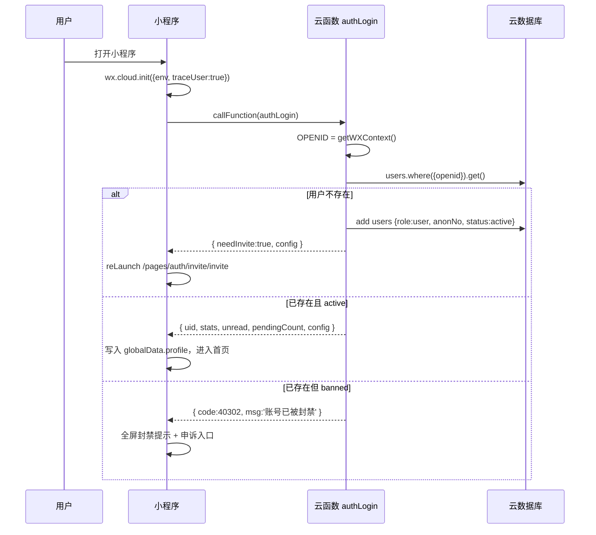
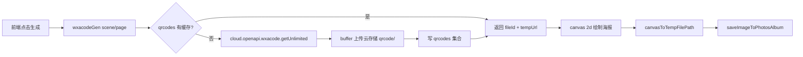
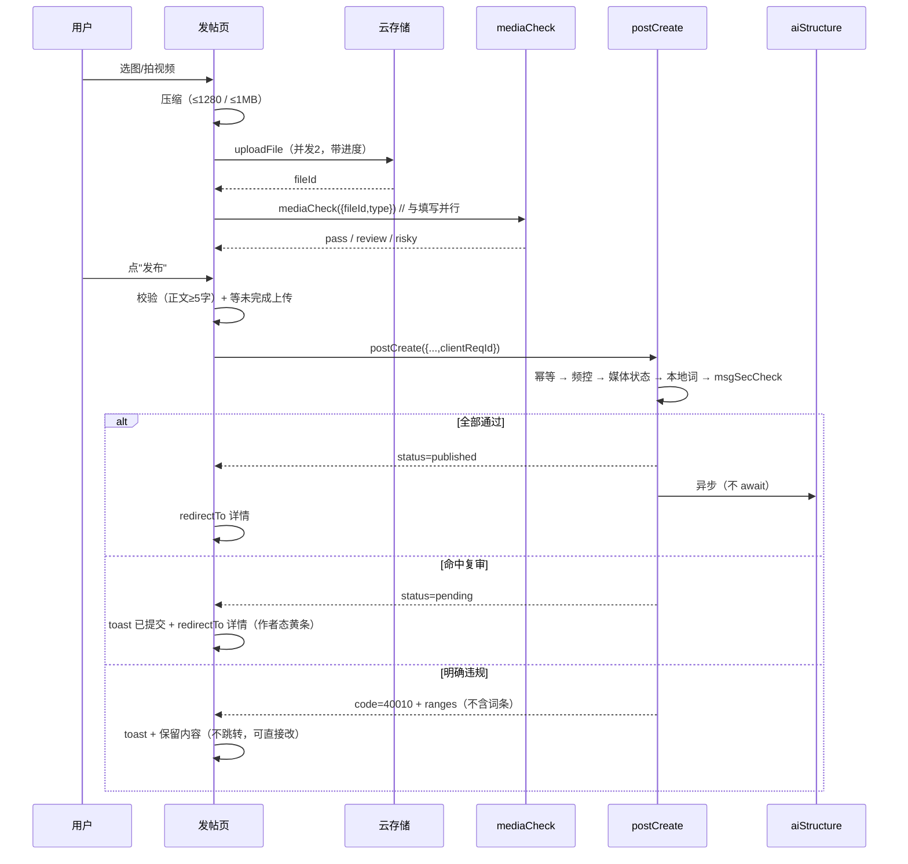
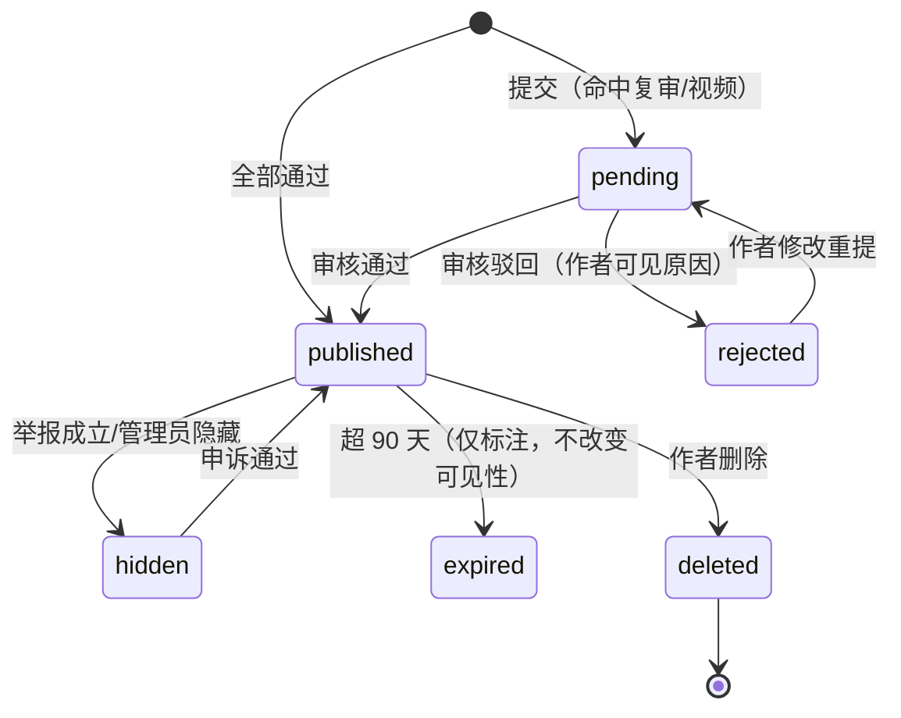

# 校园分享 · MVP 产品开发文档

> 版本 v1.0 ｜ 日期 2026-10-24 ｜ 状态：**可进入开发（Ready for Dev）**
>
> 适用范围：第九届传智杯省赛作品（体验版交付），同时按"可正式上线"的合规要求预留改造点。
>
> 。
>
> 前端：微信小程序原生（WXML / WXSS / JS / JSON，无第三方框架）
>
> 后端：腾讯云 CloudBase（文档型 NoSQL + 云函数 + 云存储），环境 `campus-share-prod` / `campus-share-dev`

---

## 目录

1. [文档说明与术语](#1-文档说明与术语)
2. [设计稿基线（视觉与组件）](#2-设计稿基线视觉与组件)
3. [设计稿 × 平台能力：冲突裁决表](#3-设计稿--平台能力冲突裁决表)
4. [信息架构与页面路由](#4-信息架构与页面路由)
5. [组件拆分](#5-组件拆分)
6. [页面规格：布局·数据·交互·状态](#6-页面规格布局数据交互状态)
7. [全局状态与交互规范](#7-全局状态与交互规范)
8. [数据模型（集合结构）](#8-数据模型集合结构)
9. [云函数清单与出入参契约](#9-云函数清单与出入参契约)
10. [无感登录与身份体系](#10-无感登录与身份体系)
11. [图片与视频](#11-图片与视频)
12. [链接上传](#12-链接上传)
13. [小程序码生成](#13-小程序码生成)
14. [文字输入与发布链路](#14-文字输入与发布链路)
15. [内容安全审核](#15-内容安全审核)
16. [权限与隐私](#16-权限与隐私)
17. [异常处理与可观测性](#17-异常处理与可观测性)
18. [性能预算](#18-性能预算)
19. [部署流程](#19-部署流程)
20. [测试用例](#20-测试用例)
21. [验收清单](#21-验收清单)
22. [排期与任务拆分](#22-排期与任务拆分)
23. [风险登记](#23-风险登记)
24. [附录](#24-附录)

---

## 1. 文档说明与术语

### 1.1 本文档解决什么

把"已确认的设计稿 + 需求方案"翻译成**可直接编码的契约**：页面有哪些、怎么跳、每个组件收什么参数、每个状态怎么变、每张表存什么字段、每个云函数吃进什么吐出什么、出事怎么兜底、上线怎么部署、验收怎么判。

读完不需要再问"这里应该怎么做"，只允许问"这里要不要改"。凡设计稿与平台能力冲突处，已在第 3 章给出裁决与替代方案，开发按裁决实现，不按设计稿硬做。

### 1.2 术语

| 术语         | 含义                                          |
| ---------- | ------------------------------------------- |
| 板块 board   | `life` 生活 / `study` 学习 / `food` 美食，三选一，不可多选 |
| 匿名         | 前台唯一展示身份，所有用户显示"匿名"；评论区以"匿名 #楼层号"区分         |
| 无感登录       | 用户无需任何授权操作，云函数用 `OPENID` 直接识别并初始化账号         |
| 三层过滤       | 本地敏感词 → 微信官方内容安全 → AI 粗分，之后接人工复审            |
| 待审 pending | 内容已入库但不公开展示，仅作者在"我的分享"可见                    |
| 降权         | 排序权重下调 / 展示"可能已过期"角标，不删除内容                  |
| 引用 cited   | AI 问答回答中引用了某帖，计入该帖 `citedCount`（仅作者可见）      |
| 契约         | 云函数入参/出参/错误码的固定约定，前后端以此为准                   |

### 1.3 角色与责任

| 角色      | 负责             | 交付物                              |
| ------- | -------------- | -------------------------------- |
| 前端 ×1-2 | 页面/组件/交互/异常态   | `miniprogram/` 全部代码、真机走查记录       |
| 后端 ×1   | 集合/云函数/审核链路/AI | `cloudfunctions/`、索引与权限配置、接口自测报告 |
| 运营 ×1   | 种子内容、邀请码、复审、验收 | 50 条种子帖、审核台账、演示脚本                |

### 1.4 开发硬约束（不可协商）

1. 前端**不直连数据库读写**，全部走云函数；数据库权限一律"所有用户不可读写"。
2. 前端**不持有 openid/uid 之外的身份凭据**，也不得在页面 data 中存放 openid。
3. 任何写操作必须带 `clientReqId`（幂等键），服务端唯一索引兜底。
4. 任何公开展示的内容，必须 `status = published` 且 `risk.level = pass`。
5. AI 回答必须带 ≥1 条站内引用，否则走"无内容"分支，**绝不裸答**。
6. 视觉数值以设计稿标注为准，本文数值为基线，允许 ±4rpx 误差。

---

## 2. 设计稿基线（视觉与组件）

### 2.1 设计稿页面清单（Ardot v4 软萌手账，9 画板）

| #  | 画板            | 节点 ID | 落地路由                           | 说明                                                   |
| -- | ------------- | ----- | ------------------------------ | ---------------------------------------------------- |
| S1 | 首页 Home       | `4:1` | `pages/index/index`            | 渐变底 + 圆体大标题 + 胶囊搜索框 + AI 引导卡 + 分类贴纸 + 信息流 + FAB「发一条」 |
| S2 | 板块页 Board     | `4:2` | `pages/board/board`            | 板块头 + 帖子卡（含"可能已过期"胶囊角标）                              |
| S3 | 发帖页 Create    | `4:3` | `pages/post/create/create`     | 板块 chips + 标题/正文 + 媒体网格 + 补充信息                       |
| S4 | 详情页 Detail    | `4:4` | `pages/post/detail/detail`     | 沉浸式头图 + 字段 chips + 作者私密卡 + 评论预览 + 底部操作栏              |
| S5 | AI 问答 Ask     | `4:5` | `pages/ask/ask`                | 对话流 + 引用卡 + AI 声明                                    |
| S6 | 我的 Profile    | `4:6` | `pages/profile/profile`        | 糖果色"匿"头像（右下相机角标）+ 数据卡 + 菜单 + 退出                      |
| S7 | 审核后台 Admin    | `4:7` | `pkg-admin/admin/admin`        | 待审 / 举报 / 已处理（页面标题显示"审核台"）                           |
| S8 | 评论页 Comments  | `39:1` | `pages/post/comments/comments` | 帖子摘要卡 + 一级评论流 + 浅紫二级回复块 + 底部输入栏                      |
| S9 | 站内消息 Messages | `39:2` | `pages/me/messages/messages`   | 全部 / 评论 / 赞和收藏 三 Tab + 通知卡 + 未读淡紫底                   |

**顺序锁定（硬约束）**：上表 9 行 = 索引《设计稿结构索引.md》画板 1–9 的原始顺序，编号（画板 N / SN）、命名、节点 ID 与索引逐字对应，**不得增删、合并、拆分、调整或重排**；4.1、6.1–6.9 与代码注册顺序必须同序。

**索引外流程必需页**：邀请码 / 搜索 / 我的分享 / 我的收藏 / 关于 这 5 页不在索引内，**不占用画板编号，统一排在 S9 之后**（见 4.2、6.10），实现顺序同样排在 9 个画板页之后。

**组件与状态**（按钮 / 输入框 / Chip / Toast / 板块标签 / 骨架屏）在索引中没有独立画板，规格见 2.3、2.4 与第 5 章，**不单列为页面条目**。

> 与 v3 旧稿的差异（必须知悉）：v3 为纯白底 + 青绿主色 + 直角感较弱的三列卡；v4 为淡紫蓝渐变底 + 白卡大圆角（48rpx）+ 糖果色贴纸 + 圆体标题 + 胶囊按钮，并新增 S8/S9 两个画板。开发**只按 v4** 实现。

### 2.2 设计令牌（Design Tokens）

落点 `miniprogram/theme.wxss`（变量名与 v3 一致，值已全量替换为 v4），页面只引用变量，禁止硬编码色值。

| 变量                        | 值                                                         | 用途                                                 |
| ------------------------- | --------------------------------------------------------- | -------------------------------------------------- |
| `--brand-50`              | `#F7F4FF`                                                 | 极浅紫底                                               |
| `--brand-100`             | `#EDE9FE`                                                 | 淡紫底：标签、私密卡、AI 信息底                                  |
| `--brand-200`             | `#DCD3FB`                                                 | 淡紫描边                                               |
| `--brand-700`             | `#6C5CE7`                                                 | **主色**：按钮底、选中 chip、Tab 选中、赞/藏激活（白字 4.85:1）         |
| `--brand-800`             | `#5A47C9`                                                 | **淡紫底上的紫色文字**、链接、hover（5.6:1）                      |
| `--brand-900`             | `#4A3AAE`                                                 | 按压态                                                |
| `--bg-page`               | `#F5F1FF`                                                 | 页面渐变起点，`page` 上做 `180deg` 渐变到 `#EAF4FF`；实底回退此值     |
| `--bg-card`               | `#FFFFFF`                                                 | 卡片，**无描边**，阴影 `0 16rpx 48rpx rgba(108,92,231,.08)` |
| `--bg-field`              | `#F7F4FF`                                                 | 输入框、正文框、骨架屏                                        |
| `--border`                | `#EAE4F6`                                                 | 分隔线（卡片本身不用描边）                                      |
| `--border-strong`         | `#D9D0F0`                                                 | 未选中 chip、虚线框                                       |
| `--text-1`                | `#2E2A3B`                                                 | 标题、正文（13:1）                                        |
| `--text-2`                | `#6B6780`                                                 | 摘要、次级（5.4:1）                                       |
| `--text-3`                | `#716D82`                                                 | 时间、占位、说明（4.6:1）                                    |
| `--text-disabled`         | `#A9A4B8`                                                 | 禁用                                                 |
| `--danger`                | `#C73648`                                                 | 退出登录、驳回、删除                                         |
| `--warn-bg` / `--warn-fg` | `#FFF3D9` / `#7A4A00`                                     | "可能已过期""审核中"                                       |
| 生活 `--board-life`         | `#4ECDC4` / `#E3F7F5` / `#0E6E63`                         | 薄荷：主/底/字                                           |
| 学习 `--board-study`        | `#5AA9FF` / `#E7F1FF` / `#1B5FBF`                         | 天蓝：主/底/字                                           |
| 美食 `--board-food`         | `#FF7A8A` / `#FFECEF` / `#B5445C`                         | 珊瑚粉：主/底/字                                          |
| 匿名头像 `--avatar-1..5`      | `#6C5CE7` / `#4ECDC4` / `#FF7A8A` / `#FFC85C` / `#5AA9FF` | 白色"匿"字，按 `uid` 取模轮换                                |

> 对比度红线：`#6C5CE7` 放在 `#EDE9FE` 上只有 4.07:1，**淡紫底上的文字必须用 `#5A47C9`**。这条在代码评审时逐页检查。

### 2.3 字阶、形状与间距

| 场景           | 规格                                                 |
| ------------ | -------------------------------------------------- |
| 页面大标题（首页/my） | 44rpx / 圆体 / 600                                   |
| 导航标题（居中）     | 36rpx / 圆体                                         |
| 详情标题         | 40rpx / 圆体 / 600，最多 3 行                            |
| 卡片标题         | 34rpx / 600，最多 2 行                                 |
| 列表行 / 引导卡主文案 | 32rpx / 600，最多 1 行                                 |
| 正文           | 30rpx / 1.75                                       |
| 摘要           | 30rpx / 1.6，最多 2 行                                 |
| 辅助信息（时间/匿名）  | 24rpx / `--text-3`                                 |
| 页面左右边距       | 32rpx                                              |
| 卡片间距         | 24rpx                                              |
| 卡片圆角 / 图片圆角  | 48rpx / 32rpx                                      |
| 输入框高度 / 圆角   | 96rpx / 32rpx，底 `--bg-field`                       |
| 主按钮高度 / 圆角   | 88rpx / **胶囊 999**                                 |
| Chip 高度 / 圆角 | 56rpx / 胶囊                                         |
| 分类贴纸         | 96rpx 方形 / 圆角 32rpx                                |
| FAB          | 104rpx 圆形胶囊按钮（"发一条"文字版可宽 200rpx），右 32rpx，主色 + 紫晕阴影 |
| 底部操作栏        | 112rpx + `safe-area-inset-bottom`，白底上圆角 32rpx      |

**字体（有成本，必须按此实现）**：

- 标题：思源黑体cn，**小程序无内置**，用 `wx.loadFontFace` 加载**子集化 woff2**（仅标题用到的 300–500 字 + 数字，≤120KB），在 `app.js onLaunch` 预加载，`family: 'KuaiLe'`，`global: true`。
- 加载失败/超时（1.5s）→ 自动降级为系统字重 600（`font-family` 兜底链已含），**不允许因此出现布局跳动**（标题行高固定）。
- 正文/说明：`-apple-system, "PingFang SC", "Helvetica Neue", "Microsoft YaHei", sans-serif`。
- 字体域名无需配置业务域名，但必须 https、支持跨域；建议放云存储静态托管并开 CDN。

图标：线性 1.5px 圆头风格；统一 iconfont 字体（≤30KB）或 2x/3x PNG。小程序不支持 `<svg>` 标签，禁止 WXML 内嵌 SVG（贴纸类可用 PNG/WebP 切图）。

### 2.4 设计稿未定义、本文补齐的规格


| 项     | 补齐规格                                                             |
| ----- | ---------------------------------------------------------------- |
| 视频卡   | 封面 16:10 + 居中播放按钮 96rpx（白 90% 底 + 主色三角）+ 右下时长胶囊（黑 40% 底白字 22rpx） |
| 审核中标签 | `审核中`，`--warn-bg` 底 + `--warn-fg` 字，22rpx，胶囊                     |
| 空态    | 贴纸图标 200rpx + 主文案 30rpx + 副文案 24rpx + 胶囊按钮（可选）                   |
| 骨架屏   | `--bg-field` 圆角块（32rpx），1.2s 呼吸动画                                |
| 举报半屏  | 白底，上圆角 48rpx，标题 + 6 个单选行 + 取消胶囊，最大高度 70vh                        |
| 作者私密卡 | `--brand-100` 底 + `#5A47C9` 文字，圆角 32rpx，右上角"仅你可见"22rpx           |
| 二级回复块 | `--brand-50` 底，圆角 24rpx，左侧 6rpx `--brand-200` 竖线，内文 26rpx        |
| 未读消息卡 | `--brand-50` 底 + 右上 12rpx 珊瑚红点                                   |
| 更换头像  | 头像右下 36rpx 白色圆底 + 相机图标 20rpx，`--brand-200` 描边                    |

---


## 3. 设计稿 × 平台能力：冲突裁决表

> 结论先行：**9 个画板全部可落地，没有一处需要推翻设计**。但有 19 处必须按平台规则修正实现方式，其中 C-01/C-02/C-05/C-07/C-11/C-15/C-16/C-18 影响页面结构或素材，开发必须先读。

| ID       | 设计稿表现                              | 冲突 / 风险                                                               | 裁决与落地方案                                                                                                                                                                                                                                       | 影响         |
| -------- | ---------------------------------- | --------------------------------------------------------------------- | --------------------------------------------------------------------------------------------------------------------------------------------------------------------------------------------------------------------------------------------- | ---------- |
| **C-01** | 首页左上大标题"校园分享"，右上留白给胶囊              | 原生导航栏无法做到"左对齐大标题 + 内容顶到状态栏"；胶囊位置由微信控制，写死会错位                           | `navigationStyle: custom` 全局自定义导航。`navBarHeight = (capsule.top - statusBarHeight) * 2 + capsule.height`，用 `wx.getMenuButtonBoundingClientRect()` + `wx.getWindowInfo().statusBarHeight` 动态计算；右侧预留 `capsule.width + 24rpx` 禁止放可点元素。tab 页不显示返回键 | 全部页面       |
| **C-02** | 底部 tab 栏 + 悬浮「发一条」按钮               | 原生 tabBar 是原生组件，页面内容无法覆盖其上层；若改自定义 tabBar，切页会重建、易闪烁                    | **用原生 tabBar**（3 套选中/未选中图标），FAB 作为页面内 `position: fixed` 组件，`bottom = 112rpx + env(safe-area-inset-bottom) + 16rpx`。v4 的 FAB 为「＋ 发一条」胶囊（宽 200rpx、高 88rpx、圆角 999、主色实底白字 + 紫晕阴影），不是纯圆；板块页（非 tab 页）`bottom = 32rpx + safe-area`                   | 首页、板块页     |
| **C-03** | 无邀请码/注册页                           | 需求要求"邀请码注册"，9 画板未包含                                                   | 新增 `pages/auth/invite` 全屏页（渐变底 + 圆体大标题 + 胶囊按钮）。支持三种带入：小程序码 `scene=i:XXXX`、`query.invite`、手动输入。未绑定用户进入任何页面均 `reLaunch` 到该页                                                                                                                     | 索引外页 P0（同源） |
| **C-04** | 首页有搜索框，无搜索结果页                      | 搜索是主路径之一，必须有结果页                                                       | 新增 `pages/search/search`：自动聚焦 + 历史词 + 热门词 + 结果列表（复用 `post-card`）。首页搜索框为"假输入框"（点击跳转），不在首页做真实输入                                                                                                                                                 | 索引外页 P0（同源） |
| **C-05** | "一句话概括（选填）"+ 正文 `0/2000`           | 与需求"一句话正文唯一必填"表述不一致，易被实现成"标题必填、正文可空"                                  | **正文必填（≥5 字，≤2000 字），标题选填（≤40 字）**。发布按钮可用态只由"正文 ≥5 字"决定，视觉与设计稿一致；标题空则详情页不渲染标题行                                                                                                                                                                | 发帖页、详情页    |
| **C-06** | 媒体区只有一个 `+`，点击直接选图                 | 需求要求支持视频，设计稿无视频入口与视频样式                                                | `+` 点击弹 `wx.showActionSheet`：`从相册选图片` / `拍摄或选择视频`。**图片与视频互斥**（图片 ≤6 或 1 个视频），避免卡片布局与审核复杂度翻倍。选视频后格子换成封面 + 时长 + 播放角标                                                                                                                            | 发帖页、详情页、卡片 |
| **C-07** | 详情头图顶到状态栏                          | 原生导航会压住图片；返回键在深色图片上不可见                                                | 详情页同样 `custom` 导航：头图 `swiper` 高 = `屏宽 × 0.75`，从 `top: 0` 起绘；返回键 72rpx 半透明黑圆底白箭头，`top = statusBarHeight + 8rpx`；`onPageScroll` 节流 100ms，滚动 >80px 时导航渐变为白底 + 标题                                                                                 | 详情页        |
| **C-08** | 评论区"匿名 #3"                         | 并发下用 `count + 1` 生成楼层会重号                                              | 楼层号由 `posts.commentSeq` 原子自增产生：云函数内 `db.runTransaction` 先 `inc(1)` 再读回，作为 `comments.floor`。**不用** `comments.count()`，也不用前端生成                                                                                                                  | 详情页、评论页    |
| **C-09** | "退出登录"红字按钮                         | 小程序无账号密码体系，`openid` 不可注销，"退出"没有真实语义；法规要求提供"注销账号"                      | 按钮保留，改&#x4E3A;**"清除本机数据并退出"**：二次确认 → 清 storage/缓存 → `reLaunch` 邀请码页；服务端不解除绑定。另在"关于"页提供**注销账号**（7 天冷静期）满足合规                                                                                                                                    | 我的、关于      |
| **C-10** | 我的页有"审核台"入口 + 红色角标                 | 普通用户不应看到该入口，更不应能查到待审数量（越权）                                            | 入口按 `role === 'admin'` 条件渲染（`wx:if`）；角标数字来自 `meOverview.pendingCount`，**仅对 admin 计算并下发**；`pkg-admin` 在 `onLoad` 二次校验，非 admin 展示 404 空态并上报                                                                                                     | 我的、审核后台   |
| **C-11** | S4 已有作者私密卡与小紫标                     | 设计稿未画"审核中/已驳回/已隐藏"状态条、作者操作（编辑/删除）、申诉入口                                | 在私密卡上方加**作者状态条**（`--warn-bg`/`--error-bg`/`--bg-field` 三态 + 说明文案 + 操作）；私密卡用 `--brand-100` 底 + `#5A47C9` 字（不能用 `#6C5CE7`，对比度不足）；非作者不下发 `citedCount` 与状态条                                                                                       | 详情页        |
| **C-12** | 补充信息只有"店名/窗口、人均、位置"                | 学习板块字段不同；"位置"若做地图跳转会触发定位授权与地图能力                                       | 字段按板块动态渲染（见 14.2）；"位置"**是纯文本**，不支持点导航。跳地图需经纬度 + `wx.openLocation` + 授权，MVP 不做                                                                                                                                                                 | 发帖页、详情页    |
| **C-13** | 无分享/小程序码入口                         | 分享是冷启动主渠道；小程序码需服务端生成并落库                                               | 详情页 `onShareAppMessage`/`onShareTimeline`；"我的"页新增"分享给同学" → 生成带 `scene` 的小程序码海报（canvas 2d）。`scene` ≤32 字符，用 `shortId`/邀请码，不用 `_id`                                                                                                             | 详情页、我的     |
| **C-14** | 正文可含外链/淘口令                         | 小程序禁止跳转淘宝/京东；`web-view` 仅支持已备案自有域名，UGC 外链不可用                          | 链接只存文本，展示为"复制链接"（`wx.setClipboardData`）+ 风险提示；不跳转、不识别二维码图片。详见第 12 章                                                                                                                                                                           | 发帖页、详情页、评论 |
| **C-15** | 标题使用站酷快乐体（ZCOOL KuaiLe 圆体）         | 小程序**不支持 CSS `@font-face` 本地字体**，且中文字体动辄 3–8MB，全量加载会拖垮首屏              | `wx.loadFontFace` 加载**子集化 woff2**（仅标题字 + 数字，≤120KB，云存储 CDN），`onLaunch` 预加载、`global:true`、1.5s 超时；失败降级系统 600 字重。标题行高固定，避免字体切换导致跳动。**若 W1 测试发现 iOS 首屏明显变慢，则整体降级为系统粗体，视觉损失可接受**                                                                  | 全站标题       |
| **C-16** | S8 评论页含"浅紫二级回复块 + 展开回复"            | 需求方案只列了平铺评论；二级回复会增加数据结构、渲染与审核面                                        | **做单层子回复**（`parentId` 指向一级评论，不允许无限层），二级直接内联展示、不折叠（数量少时更易读）；层级 >1 的回复一律挂到其一级父评论下，文案显示"回复 匿名 #3"。成本约 +1.5 人天，已计入 W2                                                                                                                             | 评论页、详情页    |
| **C-17** | S9 站内消息分"全部/评论/赞和收藏"三 Tab，含点赞/收藏通知 | 点赞/收藏是高频轻动作，逐条写消息会造成写入放大（热门帖 100 赞 = 100 条消息）                         | 三 Tab 保留（纯前端筛选，服务端按 `type` 分组返回 `counts`）；**点赞/收藏通知按"帖子 + 24h"合并**为一条（`_id = like:{postId}:{yyyyMMdd}`，`count` 累加），不逐条写                                                                                                                       | 消息页、互动     |
| **C-18** | S6 头像支持上传自定义照片（右下相机角标）             | 与"匿名、不采集头像"的隐私最小化原则冲突；且头像属图片内容，需过审核                                   | 头像**完全可选**：默认按 `uid` 取模的糖果色"匿"字头像；上传后走 `imgSecCheck` + 人工兜底，可一键恢复默认；隐私指引增加"头像（可选）"声明。未上传用户不产生任何头像数据                                                                                                                                           | 我的、评论、消息   |
| **C-19** | `design-preview/` 现存的 8 张 PNG      | 这批图是 **v3 青绿版**导出（纯白底、青绿主色、7 屏），与已确认的 v4 紫罗兰版不一致，直接照做会做出错误配色、且缺 S8/S9 | 以 Ardot v4（fileId 739654946579466）+ 本文 2.2 令牌为唯一准绳；旧 PNG 仅用于看版式结构。W1 第一天由设计同学导出 v4 的 9 屏 PNG 覆盖 `design-preview/`，避免继续误用                                                                                                                      | 交付物料       |

> 另有 6 项非结构性风险，已在实现层处理：深色模式锁定（`"darkmode": false`）、自定义导航在 iPad 的胶囊偏移（每次 `onShow` 重算）、`textarea` 键盘遮挡（`bindkeyboardheightchange` 手动位移）、`video` 同层渲染（基础库 ≥ 2.20）、`previewImage` 需 https 临时链接（`getTempFileURL` 批量换取）、页面栈上限 10 层（分享进入详情时返回键 `reLaunch` 首页）。

---

## 4. 信息架构与页面路由

### 4.1 设计稿页面（S1–S9，开发必做）

页面范围以设计稿为准：**对外可见页面 = 画板 S1–S9**，路由与画板一一对应。下表行序即索引画板 1–9 顺序，**不得调整**；索引外流程必需页统一排在 S9 之后（4.2）。

| 画板 | 节点 ID | 页面    | 路由                             | 类型  | 参数                                                    | 进入方式                       |
| -- | ----- | ----- | ------------------------------ | --- | ----------------------------------------------------- | -------------------------- |
| S1 | `4:1` | 首页    | `pages/index/index`            | tab | —                                                     | 启动页 / tab                  |
| S2 | `4:2` | 板块页   | `pages/board/board`            | 普通  | `board=life\|study\|food`、`from=share\|search\|index` | 首页分类贴纸 / 分享卡片 / 小程序码       |
| S3 | `4:3` | 发帖页   | `pages/post/create/create`     | 普通  | `board`（可选，预选板块）                                      | 首页 FAB / 板块页 FAB / 空态按钮    |
| S4 | `4:4` | 详情页   | `pages/post/detail/detail`     | 普通  | `id`（帖子 `_id`）或 `sid`（`shortId`，扫码带入）                 | 列表 / 引用卡 / 分享 / 小程序码       |
| S5 | `4:5` | AI 问答 | `pages/ask/ask`                | tab | `q`（仅 `switchTab` 后用 `globalData` 传递）                 | tab / 首页 AI 引导卡            |
| S6 | `4:6` | 我的    | `pages/profile/profile`        | tab | —                                                     | tab                        |
| S7 | `4:7` | 审核后台  | `pkg-admin/admin/admin`        | 分包  | `tab=pending\|report\|done`                           | 我的 → 审核台（`role=admin` 才渲染） |
| S8 | `39:1` | 评论页   | `pages/post/comments/comments` | 普通  | `id`、`focus=comment`（自动聚焦输入框）                         | 详情页"查看全部 N 条评论" / 站内消息     |
| S9 | `39:2` | 站内消息  | `pages/me/messages/messages`   | 普通  | `tab=all\|comment\|social`                            | 我的 → 站内消息 / 红点             |

分包策略：`pkg-admin` 放分包（主包 ≤2MB 约束），主包只放 tab 页与高频页。tabBar 页不得放分包。

### 4.2 索引外流程必需页（5 个，排在 S1–S9 之后，不参与画板编号）

这 5 个页面不在索引的 9 个画板内，但**索引自身的入口指向它们**：S1 的搜索框、S6 的"我的分享 / 我的收藏 / 关于"菜单、首启邀请码门禁——缺任意一个，链路会断在死路上。**处理方式：不占用画板编号，统一排在 S9 之后，实现顺序也在 9 个画板页之后；视觉只能复用画板语言，不得发明第二套。** 它们只能"用画板已有的语言重新排列"，不能"发明新的语言"。

| 页面   | 路由                             | 参数                       | 为什么必须有                                        | 优先级 | 视觉原型（取自哪个画板）                   |
| ---- | ------------------------------ | ------------------------ | --------------------------------------------- | --- | ------------------------------ |
| 邀请码  | `pages/auth/invite/invite`     | `code`、`scene`（扫码）       | 无感登录（第 10 章）的前置门禁：首启、换机、清缓存后都需要落点，否则用户进不了任何页面 | P0  | S6：渐变底 + 圆体大标题 + 白卡 + 胶囊主按钮    |
| 搜索   | `pages/search/search`          | `keyword`、`board`、`from` | S1 的搜索框是"假输入框"（点击跳转），没有结果页这个框就是死的             | P0  | S1 信息流 + S3 的 `--bg-field` 输入框 |
| 我的分享 | `pages/me/posts/posts`         | `tab=all\|pending`       | S6 数据卡"我的分享"、审核结果消息、驳回申诉的落点                   | P1  | S4 卡片缩略图 + 2.4 的"审核中"标签        |
| 我的收藏 | `pages/me/favorites/favorites` | —                        | S6 数据卡"我的收藏"的落点                               | P1  | 直接复用 `post-card`               |
| 关于   | `pages/about/about`            | —                        | 用户协议、隐私政策、版本号、**注销账号**（合规必需，见 C-09）           | P1  | S6 的 `menu-cell` 组             |

**索引外页视觉一致性硬约束（Code Review 逐条打勾，违反即退回）**

| #        | 约束       | 具体要求                                                                                                                                |
| -------- | -------- | ----------------------------------------------------------------------------------------------------------------------------------- |
| **V-01** | 配色只用令牌   | 除 `theme.wxss` 外，页面与组件 WXSS **不得出现十六进制色值**。验收命令：`grep -rn "#[0-9A-Fa-f]\{3,6\}" pages/ components/` 只应命中 `theme.wxss`               |
| **V-02** | 主色用量守恒   | 一屏只允许**一处主色实底**（主按钮 / FAB / 选中态三选一），其余强调一律 `--brand-100` 底 + `--brand-800` 字。索引外页最常见的翻车是"想突出就多刷一块紫"                                  |
| **V-03** | 按钮只有三种形态 | 主按钮（88rpx 胶囊、`--brand-700` 实底白字）/ 次按钮（胶囊、白底 + `--border-strong` 描边）/ 文字按钮（30rpx `--brand-800`）。**不新增第四种**，不改圆角、不换描边色                |
| **V-04** | 字体与字号同一套 | 标题 `KuaiLe` 圆体（失败降级系统 600），正文 `PingFang SC` 兜底链；字号只能取 2.3 字阶 `44 / 40 / 36 / 34 / 32 / 30 / 26 / 24 / 22rpx`，**不得临时新增中间值（如 28rpx）** |
| **V-05** | 卡片同一套    | 白卡 + 圆角 48rpx + 阴影 `0 16rpx 48rpx rgba(108,92,231,.08)`，**无描边**；输入框与占位块用 `--bg-field` + 圆角 32rpx                                    |
| **V-06** | 背景同一套    | 页面统一 `page` 渐变 `180deg`：`#F5F1FF → #EAF4FF`。索引外页**不得**用纯白或纯色底"图省事"                                                                   |
| **V-07** | 组件必须复用   | 列表用 `post-card`、空态用 `page-state`、加载用 `skeleton`、导航用 `nav-bar`。**禁止手写一份"看起来差不多"的卡片**                                                 |
| **V-08** | 图标与插图同一套 | 只用项目 iconfont（线性 1.5px 圆头）或同规格 2x/3x PNG；空态贴纸沿用 2.4 的 200rpx 规格，不引入第三方图标库                                                           |

> 一句话判断标准：**把索引外页和 S1–S9 的截图贴在一张板子上，看不出"这两批不是一个设计师做的"，才算过。** 做不到就退回 4.2 的降级方案（S1 搜索框、S6 数据卡改不可点）；既然保留这 5 页，就按上面 8 条做，别走降级。

### 4.3 `app.json` 关键配置

```json
{
  "pages": [
    "pages/index/index",
    "pages/board/board",
    "pages/post/create/create",
    "pages/post/detail/detail",
    "pages/ask/ask",
    "pages/profile/profile",
    "pages/post/comments/comments",
    "pages/me/messages/messages",
    "pages/auth/invite/invite",
    "pages/search/search",
    "pages/me/posts/posts",
    "pages/me/favorites/favorites",
    "pages/about/about"
  ],
  "subpackages": [
    { "root": "pkg-admin", "pages": ["admin/admin"] }
  ],
  "window": {
    "navigationStyle": "custom",
    "backgroundColor": "#F5F1FF",
    "backgroundTextStyle": "dark",
    "navigationBarTextStyle": "black",
    "darkmode": false
  },
  "tabBar": {
    "custom": true,
    "color": "#6B6780",
    "selectedColor": "#5A47C9",
    "backgroundColor": "#FFFFFF",
    "borderStyle": "white",
    "list": [
      { "pagePath": "pages/index/index", "text": "首页" },
      { "pagePath": "pages/ask/ask", "text": "问答" },
      { "pagePath": "pages/profile/profile", "text": "我的" }
    ]
  },
  "permission": {
    "scope.writePhotosAlbum": { "desc": "用于保存分享海报到相册" }
  },
  "requiredPrivateInfos": [],
  "lazyCodeLoading": "requiredComponents",
  "sitemapLocation": "sitemap.json"
}
```

> **注册顺序说明**：`pages` 数组按索引顺序排列——S1→S2→S3→S4→S5→S6→（S7 在分包，见下）→S8→S9，其后才是 5 个索引外页。首项必须保持 `pages/index/index`（启动页即 S1，与索引一致）。
>
> **S7 位置说明**：S7 审核后台因体积策略放分包 `pkg-admin`，分包页不能写进 `pages` 数组、也不能设为 tab 页；它在索引中的位置仍是第 7 位，跳转与接口按 S7 处理，**不因分包改变顺序**。
>
> **底部导航四项顺序（与 S1 一致）**：① 首页（`switchTab`）→ ② 问答（`switchTab`）→ ③ **发布**（动作项，`navigateTo` S3）→ ④ 我的（`switchTab`）。平台限制：写进 `tabBar.list` 的每一项都会成为 tab 页，所以"发布"不能写进 `list`，只能由 `custom-tab-bar` 渲染为第 3 个视觉项并触发跳转——**视觉严格四项，JSON 中仍是三个真实 tab 页**（`custom: true` 与此一致）。

### 4.4 跳转规则

| 场景              | API                                                       | 理由                                                                                   |
| --------------- | --------------------------------------------------------- | ------------------------------------------------------------------------------------ |
| tab 之间          | `wx.switchTab`                                            | 只能跳 tab 页，**不能带参数**；需要传参时写 `getApp().globalData.pendingAsk = {q}`，目标页 `onShow` 消费后清空 |
| 列表 → 详情         | `wx.navigateTo`                                           | 保留返回栈                                                                                |
| 发帖成功 → 详情       | `wx.redirectTo`                                           | 用详情替换表单，避免返回到已提交的表单                                                                  |
| 邀请码通过 → 首页      | `wx.reLaunch`                                             | 清空栈，避免用户返回邀请码页                                                                       |
| 详情页无上级（分享/扫码进入） | 自定义返回键判断 `getCurrentPages().length === 1` → `reLaunch` 首页 | 否则 `navigateBack` 无响应                                                                |
| 分享路径            | `onShareAppMessage` 返回 `/pages/post/detail/detail?id=xxx` | 落地页必须是已发布页面                                                                          |
| 小程序码落地          | `/pages/post/detail/detail?sid=xxx`                       | `scene` 经 `decodeURIComponent` 后解析                                                   |

栈深控制：详情页内不再 `navigateTo` 详情页（引用卡点击时若已在详情页，用 `redirectTo`），保证最深路径 `首页 → 板块 → 详情` = 3 层，远低于 10 层上限。

---

## 5. 组件拆分

### 5.1 目录结构

```
miniprogram/
├── app.js / app.json / app.wxss
├── theme.wxss                    # 设计令牌（唯一色值来源）
├── custom-tab-bar/               # 预留（当前用原生 tabBar，C-02）
├── assets/{tab,icons,empty}/
├── utils/
│   ├── cloud.js                  # callFn 封装：超时/重试/错误码/loading
│   ├── auth.js                   # 登录态缓存、守卫、重定向
│   ├── media.js                  # 选择/压缩/上传/进度/重试
│   ├── format.js                 # 相对时间、数字缩写、字符计数
│   ├── throttle.js               # 防抖/节流/单飞锁
│   └── config.js                 # 环境ID、板块定义、限流参数
├── components/
│   ├── nav-bar/                  # 自定义导航（标题/返回/透明/滚动渐变）
│   ├── page-state/               # loading / empty / error / offline 四态
│   ├── skeleton/                 # 列表/详情/对话三种骨架
│   ├── post-card/                # 信息流卡片（含过期角标、视频角标）
│   ├── post-meta/                # "匿名 · 2天前" + 赞/藏数
│   ├── board-chip/               # 板块标签（三色）
│   ├── board-filter/             # 首页/板块页 chips 组（含"全部"）
│   ├── media-grid/               # 发帖页九宫格（增删/进度/视频封面）
│   ├── field-input/              # 浅底输入框（标题/短文本）
│   ├── field-chips/              # 详情页字段 chips（¥8 / 一食堂二楼）
│   ├── action-bar/               # 详情页底部操作栏（评论框+赞+藏+举报）
│   ├── comment-item/             # 匿名 #N 评论行（含二级回复块、展开）
│   ├── user-avatar/              # 糖果色"匿"头像 / 自定义头像 / 相机角标
│   ├── msg-card/                 # 站内消息卡（类型贴纸 + 未读态）
│   ├── chat-bubble/              # AI/用户气泡
│   ├── cite-card/                # 回答内引用帖卡
│   ├── ai-disclaimer/            # "内容由 AI 生成"固定声明
│   ├── status-tag/               # 审核中 / 可能已过期 / 已隐藏
│   ├── private-card/             # 作者私密数据卡
│   ├── report-sheet/             # 举报半屏
│   ├── empty-invite/             # 空态（可用于引导发帖）
│   ├── stat-card/                # 我的页三列数据卡
│   └── menu-cell/                # 我的页菜单行（含红点/角标/右侧文本）
└── pages/…
```

### 5.2 组件契约

| 组件             | properties                                                                                                  | events                                                 | 说明                                                                      |
| -------------- | ----------------------------------------------------------------------------------------------------------- | ------------------------------------------------------ | ----------------------------------------------------------------------- |
| `nav-bar`      | `title:String`、`back:Boolean`、`transparent:Boolean`、`scrollTop:Number`、`bgColor:String`、`titleColor:String` | `back`                                                 | 内部计算状态栏与胶囊高度；`transparent=true` 时按 `scrollTop` 插值背景透明度（0→1，阈值 80px）     |
| `page-state`   | `state:'loading'\|'empty'\|'error'\|'offline'`、`emptyText`、`emptySub`、`btnText`                             | `retry`、`action`                                       | 统一四态，页面只切 `state`                                                       |
| `skeleton`     | `type:'list'\|'detail'\|'chat'`、`count:Number`                                                              | —                                                      | 纯样式，不请求数据                                                               |
| `post-card`    | `post:Object`、`showBoard:Boolean`                                                                           | `tap`、`like`、`fav`                                     | 图片/视频封面二选一渲染；`post.expired=true` 显示角标；`post.status==='pending'` 显示"审核中" |
| `post-meta`    | `createdAt:Number`、`likeCount`、`favCount`、`liked`、`faved`                                                   | `like`、`fav`                                           | 数字 >999 显示 `1.2k`                                                       |
| `board-filter` | `value:String`（`all` 或板块 key）、`counts:Object`                                                               | `change`                                               | 横向排列，不分页滚动（4 项）                                                         |
| `media-grid`   | `list:Array`、`max:Number`、`uploading:Boolean`、`progress:Number`                                             | `add`、`remove`、`preview`、`retry`                       | 视频项用 `type==='video'` 渲染封面 + 时长；上传中显示环形进度遮罩                             |
| `field-input`  | `label`、`value`、`placeholder`、`maxlength`、`type:'text'\|'digit'`                                            | `input`、`blur`                                         | 受控组件，不在内部存状态                                                            |
| `action-bar`   | `post:Object`、`isMine:Boolean`、`disabled:Boolean`                                                           | `comment-focus`、`like`、`fav`、`report`、`submit-comment` | 键盘弹起时 `transform: translateY(-keyboardHeight)`                          |
| `comment-item` | `comment:Object`、`showReply:Boolean`                                                                        | `tap`、`reply`、`expand`、`longpress`                     | 头像用 `user-avatar`；文案 `匿名 #{{floor}}`；`replies` 用品牌浅紫块渲染，>3 条显示"展开更多"    |
| `user-avatar`  | `size:Number`、`avatar:Object`、`uid:String`、`editable:Boolean`                                               | `tap`                                                  | `avatar.fileId` 为空时按 `uid % 5` 取糖果色 + 白"匿"；`editable` 时右下显相机角标          |
| `msg-card`     | `msg:Object`                                                                                                | `tap`                                                  | 未读时整卡 `--brand-50` 底 + 右上红点；`count>1` 显示"等 N 人"                         |
| `chat-bubble`  | `role:'ai'\|'user'`、`text`、`typing:Boolean`                                                                 | —                                                      | `typing` 时显示三点动画；文字按 30 字/帧逐步渲染                                         |
| `cite-card`    | `post:Object`                                                                                               | `tap`                                                  | 左图 120rpx + 标题 2 行 + `匿名 · 3天前`                                         |
| `report-sheet` | `visible:Boolean`、`targetType`、`targetId`                                                                   | `close`、`submitted`                                    | 5 个理由单选 + 补充说明（≤100 字）+ 提交                                              |
| `private-card` | `citedCount:Number`                                                                                         | —                                                      | 仅作者渲染，父级用 `wx:if="{{isMine}}"` 控制                                       |
| `stat-card`    | `stats:Object`                                                                                              | `tap-stat`（`dataset.key`）                              | 三列，分隔线 1px                                                              |
| `menu-cell`    | `title`、`value`、`dot:Boolean`、`badge:Number`、`arrow:Boolean`                                                | `tap`                                                  | 用于我的页菜单组                                                                |

样式隔离：组件默认 `styleIsolation: 'apply-shared'`，仅 `theme.wxss` 变量与少量工具类可穿透；组件内不写死颜色。

---

## 6. 页面规格：布局·数据·交互·状态

> 每页固定五段：布局 / 数据来源 / 交互 / 状态机 / 埋点。数值单位 rpx。
>   
> **6.1–6.9 严格对应画板 S1–S9**，顺序与设计稿一致；6.10 是索引外流程必需页（排在 S9 之后、不占画板编号），视觉必须与画板同源。

### 6.1 首页 `pages/index/index`（画板 1 · S1 · `4:1` · 115 节点）

**布局（自上而下）**

1. `nav-bar`：透明→白，高 `statusBar + 88rpx`；左侧标题"校园分享"44rpx/600，`left: 32rpx`；右侧 `capsule.width + 24rpx` 留白。
2. 搜索框：高 72rpx、圆角 36rpx、白底、1rpx `--border`；左放大镜 32rpx；占位"搜好物 / 美食 / 资料…"；点击跳搜索页。
3. AI 引导卡：高 160rpx、圆角 32rpx、白底 + 紫晕阴影；左侧 64rpx 淡紫圆底（`--brand-100`）+ 星星图标（`--brand-700`）；主文案"问问同学都在推荐什么"32rpx/600 `--text-1`；副文案"只回答本校的真实分享"24rpx `--text-2`；右侧 chevron `--text-3`。**一屏只保留这一处紫色强调**，FAB 与之不同色块冲突（FAB 在右下，空间上分离）。
4. `board-filter`：全部 / 生活 / 学习 / 美食，距上 24rpx。
5. 信息流：单列 `post-card`，间距 24rpx，左右 32rpx；封面 16:10。
6. `FAB`：见 C-02。

**数据**

- `postList({ board: 'all'|key, cursor, pageSize: 10, sort: 'hot'|'latest' })`
- 排序：默认 `hot`（`hotScore` 降序 + `createdAt` 降序）；用户下拉刷新后保持当前排序。
- 首屏并发：`postList` + `meOverview`（仅取未读数，失败不阻塞）。

**交互**

- 点搜索框 → `navigateTo /pages/search/search?from=home`。
- 点 AI 入口 → `switchTab` 到问答，`globalData.focusAskInput = true`（自动聚焦）。
- 切 chip → 本地先清列表 + 骨架屏，再请求；切换 300ms 内连续点击只发最后一次。
- 点卡片 → 详情。长按卡片 → `wx.showActionSheet`（不感兴趣/举报）。
- 下拉刷新（`enablePullDownRefresh`，背景 `#F5F1FF`，与渐变底衔接）；上拉加载（`onReachBottom` 120px 预加载）。
- 点 FAB → 发帖页，默认板块 = 当前选中 chip（`all` 时为 `life`）。

**状态机**

`idle → loading(骨架) → success | empty | error`；`success → refreshing → success`；`success → loadingMore → success | loadMoreError(底部"加载失败，点击重试")`；离线 → 顶部 64rpx 提示条"网络不可用，显示的是缓存内容"（缓存最近一页，最多 24h）。

**埋点**：`home_view`、`chip_switch{board}`、`ai_entry_click`、`post_card_click{postId,pos}`、`feed_load{page,ms}`。

### 6.2 板块页 `pages/board/board`（画板 2 · S2 · `4:2` · 65 节点）

**布局**：`nav-bar`（返回 + 居中标题 = 板块名）；下方 24rpx 处声明行"板块内容均为同学个人体验分享"24rpx `--text-3`；`board-chip` + "128 条分享"24rpx；列表同首页，卡片右上角可显示"可能已过期"。

**数据**：`postList({ board, cursor, pageSize: 10 })`；`total` 来自首次响应。

**交互**：返回；下拉刷新；上拉加载；FAB（`bottom = 32rpx + safe-area`）；非法 `board` 参数 → 空态"板块不存在"+ 返回首页按钮。

**状态**：同首页，额外 `invalidBoard`。

**埋点**：`board_view{board,from}`。

> **入口去重裁决**：首页 chips 只做"当前信息流筛选"，不跳板块页；板块页承担分享落地、小程序码落地、搜索结果按板块筛选三种场景。两个入口语义不重复。

### 6.3 发帖页 `pages/post/create/create`（画板 3 · S3 · `4:3` · 41 节点）

**布局**

1. `nav-bar`：左"取消"（32rpx，`--text-2`），右"发布"（32rpx/600，可用时 `--brand-700`，不可用 `--text-disabled`），无居中标题。
2. 板块 chips：3 个，单选，默认取 `options.board` 或 `life`；切换时清空该板块专属字段值。
3. 标题输入：`field-input`，占位"一句话概括（选填）"，maxlength 40，无计数（设计稿一致）。
4. 正文：`textarea` 高 400rpx，底 `--bg-field`，圆角 16rpx，内边距 24rpx，maxlength 2000，右下计数"0/2000"，占位"说说你的真实体验～"；`show-confirm-bar=false`，`cursor-spacing=24`。
5. `media-grid`：3 列，格子 200×200rpx，圆角 16rpx；删除按钮 40rpx 黑色半透明圆 + 白 ×；上传中显示进度遮罩（环形 + 百分比）。
6. "补充信息（选填）"：26rpx `--text-2` + 动态字段（见 14.2），每个 `field-input` 高 88rpx。
7. 底部说明两行：`前台统一显示「匿名」` / `请描述亲身经历，不要做无依据的猜测或指控`，24rpx `--text-3`，距底 `safe-area + 32rpx`。

**数据**

- 草稿：`wx.getStorageSync('postDraft')`，结构 `{board,title,content,media:[{type,fileId,thumb,localPath}],fields,savedAt}`，`savedAt + 7d` 过期自动清。
- 发布：`postCreate({ board, title, content, media, fields, clientReqId })`。

**交互**

- 取消：有内容 → `showModal("保存草稿？")`（保存并退出 / 直接退出 / 继续编辑）。
- 发布：前置校验（正文 ≥5 字、标题 ≤40、媒体数合法）→ 逐张上传（并发 2，失败重试 2 次）→ `postCreate` → 成功 `redirectTo` 详情；`status=pending` 时 toast"已提交，审核通过后展示"。
- 发布被驳回（`40010`）：**留在发帖页**，按钮恢复可用，正文框下方出现 `--danger` 提示条，命中片段标红（见 15.4）；**不回显词条、不显示类别**，草稿与已传图片全部保留，改完可直接重发。
- 上传中禁止返回？**否**：允许返回但保留草稿；返回时若有未完成上传，中断并保留已完成 `fileId`。
- 正文为空时点"发布"：`wx.showToast('写一句话再发布吧')`，不弹窗。
- 输入框聚焦时页面自动上滚，保证输入框在键盘上方。

**状态机**

`editing → validating → uploading(0-100%) → submitting → published | pending | failed`

- `submitting` 时按钮文案变"发布中"且 `disabled`，全页 `pointer-events` 不阻断（只锁提交）。
- `failed`：保留草稿 + toast"发布失败，草稿已保存" + 重试按钮（复用已上传 `fileId`，不重复上传）。
- `pending`：跳详情，作者态顶部黄色条"审核中，仅你可见，预计 2 小时内完成"。

**埋点**：`create_open{board}`、`media_add{type,count}`、`publish_submit{chars,media}`、`publish_result{status,ms}`。

### 6.4 详情页 `pages/post/detail/detail`（画板 4 · S4 · `4:4` · 58 节点）

**布局**

1. `swiper` 首图：高 = 屏宽 × 0.75，`top: 0`，沉浸；多图右下页码圆点（当前实心），单图不显示；视频项渲染 `video`（`poster` 为封面，`object-fit: cover`，`controls`）。
2. 自定义返回：64rpx 圆，`rgba(0,0,0,.32)` 底 + 白色左箭头；`top = statusBarHeight + 8rpx`；滚动后切换为白底深色箭头。
3. 内容区：白底，`padding: 32rpx`；`board-chip` + 标题（40rpx/600，≤3 行）+ `post-meta`（"匿名 · 2天前"）+ 正文 30rpx/1.75（保留换行 `white-space: pre-wrap`）。
4. 字段 chips：`field-chips`，横排可换行，每个 `padding 8rpx 16rpx`、圆角 8rpx、1rpx `--border`、24rpx `--text-2`。
5. 作者态（`isMine`）：状态条（审核中/已隐藏/已过期）+ `private-card`（被 AI 引用 N 次）+ 操作行（编辑 / 删除）。
6. 评论区（**预览态**）：标题"评论 3"30rpx/600；只展示最新 2 条一级评论（含其子回复），底部一行"查看全部 3 条评论 ›" → `pages/post/comments/comments?id=`；无评论时显示空态"还没有评论，来说两句"。
7. `action-bar`：输入框（点击聚焦）、赞（心形）、藏（星形）、举报（旗形）；激活态填充 + 主色。

**数据**

- `postDetail({ id | sid })` → `{ post, isMine, myInteraction:{liked,faved}, commentTotal }`
- `commentList({ postId, pageSize: 2 })`（仅预览，按 `floor desc` 取最新 2 条）
- 首屏两个请求并行；详情失败整页错误态，评论失败只影响预览区（显示"评论加载失败"）。

**交互**

- 点赞/收藏：乐观更新（本地 +1 / 变色，50ms 内动画），失败回滚 + toast"操作失败"；500ms 内重复点击合并为最后一次。
- 快捷评论：点输入框 → 弹出输入层（`adjust-position=false`，按 `keyboardHeight` 位移）；提交 → 先在预览区插入"发送中"骨架，成功后以服务端楼层替换，**不做乐观占位楼层**（避免重号）；发表成功后就地追加，并把"查看全部 N 条"的 N +1。
- 长评论/多回复：点"查看全部"进评论页，输入与列表在同一页，体验更完整。
- 图片点击 → `getTempFileURL` 批量换 https → `wx.previewImage`（支持左右滑、长按保存由系统提供）。
- 举报 → `report-sheet`，提交成功 toast"已收到，我们会在 48 小时内处理"。
- 删除（作者）→ `showModal` 确认 → `postDelete` → `navigateBack` 并通知列表刷新（`globalData.feedDirty = true`）。
- 分享：`onShareAppMessage`（标题=帖子标题或正文前 20 字，`imageUrl`=首图临时链接）；`onShareTimeline` 同。

**状态机**

`loading → success | notfound | removed | error`

`success → commenting → success | commentFailed`

`post.status`：`published`（正常）/`pending`（作者可见，顶部黄条）/`rejected`（作者可见，红条 + 原因 + "修改重提"）/`hidden`（作者可见，灰条"已隐藏"）/`expired`（正常展示 + 角标）。

**埋点**：`detail_view{postId,from}`、`like`、`fav`、`comment_submit`、`report_submit{reason}`、`cite_card_click`。

### 6.5 AI 问答页 `pages/ask/ask`（画板 5 · S5 · `4:5` · 53 节点）

**布局**

1. `nav-bar`：居中"AI 问答"34rpx/600，无返回。
2. 副标题："仅基于本校同学的分享回答"24rpx `--text-3`，居中，距上 16rpx。
3. 对话区：`scroll-view`（`scroll-y`，`scroll-into-view` 到底部锚点）；AI 气泡白底 + 1rpx `--border` + 圆角 24rpx（左上 8rpx）；用户气泡 `--brand-700` 底白字，右对齐（右上 8rpx）。
4. 引用卡：回答气泡内下方，可多条，间距 16rpx。
5. 底部：`ai-disclaimer` 固定行"内容由 AI 生成，仅供参考"22rpx `--text-3` 居中；输入栏高 88rpx 圆角 44rpx 底 `--bg-field` + 右侧 80rpx 主色圆形发送按钮。

**数据**

- `askQuery({ question, history: [{q,a}], clientReqId })` → `{ status:'ok'|'no_content'|'blocked'|'limited'|'error', answer, citations:[{postId,title,cover,createdAt}], requestId }`

**交互**

- 发送：非空、≤100 字；发送后输入框清空、按钮 loading、追加用户气泡 + AI 思考气泡。
- 思考中：三点动画 + 骨架 2 行；超过 8s 追加提示"还在找同学的分享…"；超过 20s 转失败态。
- 回答渲染：按 30 字/帧打字机效果（纯前端，不改变内容），渲染完成后再显示引用卡。
- 引用卡点击 → 详情（`navigateTo`，栈内已 3 层时 `redirectTo`）。
- `no_content`：气泡"这个问题还没有同学分享过"，下方引导卡"去发一条，帮后面的同学" → 发帖页（预填问题为正文）。
- `limited`：提示"今天的提问次数用完了，明天再来"。
- 追问：携带最近 3 轮 `{q,a}` 用于指代消解；切换 tab 保留会话（内存，不持久化），冷启动清空。

**状态机**

`idle → thinking → streaming → done | no_content | blocked | limited | error`

`blocked`（提问命中内容安全）：气泡"这个问题不太适合讨论，换个问法试试"。

**埋点**：`ask_send{chars}`、`ask_result{status,ms,citationCount}`、`cite_card_click`。

### 6.6 我的 `pages/profile/profile`（画板 6 · S6 · `4:6` · 81 节点）

**布局**

1. `nav-bar` 居中"我的"。
2. 身份卡：头像 144rpx 圆，默认按 `uid % 5` 取 `--avatar-1..5` 实底 + 白色"匿"字 48rpx；右下 40rpx 白底相机角标（`--brand-200` 描边）为"更换头像"入口。右侧"匿名同学"36rpx/600 + "你的身份仅自己可见"24rpx `--text-3`。
3. `stat-card`：三列 12 / 8 / 34，数字 40rpx/600，标签 24rpx，1px `--border` 竖分隔线，白卡圆角 48rpx，紫晕阴影。
4. `menu-cell` 组：我的分享 / 我的收藏 / 站内消息（红点）/ **分享给同学**（生成小程序码海报）/ 关于（右侧 `v1.0.0`）/ 审核台（`wx:if` admin，红色数字角标）。
5. "退出登录"：`--danger` 30rpx 居中，距底 `safe-area + 48rpx`。

**数据**：`meOverview()` → `{ uid, role, status, avatar, stats:{posts,favs,cited}, unread, pendingCount }`。

**交互**

- 点头像 / 相机角标 → `wx.showActionSheet`：`从相册选择` / `恢复默认头像`；选择后压缩到 400×400 上传 → `meUpdateProfile({ avatarFileId })`（服务端送审，见 11.6）；审核通过前先用本地图临时展示，失败回滚默认头像 + toast。
- 点数据卡：我的分享 / 我的收藏 / 弹层解释"被引用 = 你的分享被 AI 问答引用过，仅你可见"。
- 点"分享给同学" → `wxacodeGen({scene:'i:'+我的邀请码})` → 海报预览 → 保存/转发。
- 退出：确认弹层文案"退出后将清除本机缓存，下次进入需重新输入邀请码。你的匿名身份仍会保留。" → 清 storage → `reLaunch` 邀请码页。
- `stats` 为 0 时数字显示 0，不隐藏。

**状态**：`loading(骨架) → success | error`；被封禁用户进入 → 全屏提示"账号已被封禁"+ 申诉入口。

### 6.7 审核后台 `pkg-admin/admin/admin`（画板 7 · S7 · `4:7` · 63 节点；页面标题：审核台）

**布局**

1. `nav-bar`：返回 + "审核台"。
2. 页内分段控件：`待审 3` / `举报 1` / `已处理`；选中项主色文字 32rpx/600 + 底部 6rpx 主色指示条（宽 48rpx，圆角 3rpx）。
3. 卡片：第一行 `board-chip` + AI 判定 chip（"AI 判定：疑似指控"，`#FFECEF` 底 `#C73648` 字）+ 右侧时间；正文 3 行截断；底部按钮：`驳回`（白底 + `--border-strong` 描边、胶囊）/ `通过`（主色实底胶囊），举报卡为 `忽略` / `处理`。
4. 视频卡：封面 + 播放按钮，点击全屏播放（审核必须能看完整视频）。
5. 处理弹层：动作单选（隐藏内容 / 警告作者 / 封禁作者）+ 理由输入（≤100 字）+ 确认。

**数据**

- `adminQueue({ tab, cursor, pageSize: 20 })` → `{ list:[{queueId,targetType,targetId,board,content,media,aiLabel,reason,createdAt}], counts:{pending,report,done} }`
- `adminReview({ queueId | (targetType+targetId), action:'approve'|'reject'|'hide'|'ignore'|'banUser', reason })`

**交互**：操作后卡片移出（本地）+ 计数 -1 + toast；"已处理"列表只读；下拉刷新；`onLoad` 校验 `role`，非 admin 显示 404 空态并上报 `admin_forbidden`。

**状态**：`loading → success | empty("没有待处理的内容") | error`；`acting`（按钮 loading，防重复）。

### 6.8 评论页 `pages/post/comments/comments`（画板 8 · S8 · `39:1` · 56 节点）

**布局**

1. `nav-bar`：返回 + 居中"评论"。
2. 帖子摘要卡：左 120rpx 封面（圆角 24rpx）+ 标题 2 行 30rpx + `匿名 · 3天前`；整卡可点回详情。
3. 一级评论流：`comment-item`（头像 72rpx、`匿名 #N`、时间、正文 30rpx/1.7、右下"回复"文字按钮）。
4. 二级回复块：`--brand-50` 底、圆角 24rpx、左侧 6rpx `--brand-200` 竖线；每条显示"匿名 #M 回复 匿名 #N：内容"；超过 3 条时显示"展开更多回复（N）"。
5. 底部输入栏：白底上圆角 32rpx，输入框 + 主色圆形发送键；回复某人时输入框上方显示"回复 匿名 #N ×"可取消。

**数据**

- `commentList({ postId, cursor, pageSize: 20, withReplies: true })` → 一级评论列表，每条带 `replies[]`（最多 3 条）+ `replyCount`
- `commentReplies({ commentId, cursor })`（展开更多时）
- `commentCreate({ postId, content, parentId?, replyToFloor?, clientReqId })`

**交互**

- 回复：点某条的"回复" → 输入框聚焦并带 `parentId`；提交后追加到该条的 `replies` 末尾并 `replyCount+1`；若回复的是二级评论，`parentId` 仍取其一级父级，`replyToFloor` 记录被回复楼层（文案"回复 匿名 #N"）。
- 楼层规则：只有一级评论消耗 `floor`；二级回复不再取号，避免"#12 的回复是 #13"造成语义混乱。
- 展开：默认展示 3 条，点"展开更多回复"分页拉取。
- 删除：作者可删自己的评论（软删，占位显示"该评论已删除"），管理员可隐藏。
- 举报：长按评论 → 举报半屏（沿用 `report-sheet`，`targetType:'comment'`）。

**状态**

`loading(骨架 3 条) → success | empty | error`；`submitting`（发送按钮 loading）；`loadingMore`。

被隐藏/待审的评论：本人可见并标注"审核中"，他人不可见。

**埋点**：`comments_view{postId}`、`reply_click{floor}`、`reply_submit{parentId}`、`replies_expand`。

### 6.9 站内消息 `pages/me/messages/messages`（画板 9 · S9 · `39:2` · 68 节点）

**布局**

1. `nav-bar`：返回 + 居中"消息" + 右侧"全部已读"文字按钮（30rpx `--brand-800`，无消息时置灰不可点）。
2. 页内三 Tab：全部 / 评论 / 赞和收藏。选中 32rpx/600 `--text-1` + 底部 48rpx×6rpx 主色指示条；未选中 `--text-2`。
3. 通知卡 `msg-card`：左侧 80rpx 类型贴纸（评论=薄荷、回复=天蓝、赞和收藏=珊瑚、审核结果=淡紫、系统=`--bg-field`）；标题 30rpx/600；摘要 26rpx `--text-2` 单行省略；相对时间 22rpx `--text-3`；右上 12rpx 珊瑚红点。**未读整卡 `--brand-50` 底**。
4. 列表按 `createdAt desc` 分页 20，`onReachBottom` 预加载。

**数据**

- `meList({ type:'messages', tab:'all'|'comment'|'social', cursor, pageSize:20 })` → `{ list, counts:{all,comment,social}, nextCursor, hasMore }`
- `msgRead({ id })`、`msgReadAll()`
- Tab 归属：`comment/reply/expiry` → 评论；`like/fav` → 赞和收藏；`review/system/appeal` 只出现在"全部"（不设空 Tab）。

**交互**

- 切 Tab **只做本地筛选**，`counts` 来自同一响应，不重新发请求；埋点 `msg_tab`。
- 进页面 3s 后批量置读，但**本次会话保留进入前的未读底色**（本地记录未读 id 集合），避免"点进去全变白"的突兀感；下次进入即为已读态。
- 点卡片：先置读再跳转 —— 评论/回复 → `pages/post/comments/comments?id=&focus=comment`；赞和收藏 → 详情页；审核结果 → 我的分享；系统/申诉 → 关于页。置读失败**不阻塞**跳转。
- 右上"全部已读"：无二次确认，直接清红点 + 清未读底色，toast"已全部标为已读"。
- 下拉刷新重拉第一页并更新 `counts`；空态"暂时没有消息"。
- tabBar"我的"的红点由 `meOverview().unread` 驱动，`msgReadAll` 后同步清零。

**状态**

`loading`（骨架 3 条）→ `success | empty | error`；`refreshing`；`reading`（仅按钮 loading）。

**消息合并展示**

赞/收藏按"帖子 + 24h"合并（见 8.10）：`count>1` 时文案"{{name}} 等 {{count}} 人赞了你的分享"，点击进详情，不做逐条展开。

**埋点**：`msg_view{tab}`、`msg_click{type}`、`msg_read_all`。

### 6.10 索引外流程必需页规格（排在 S1–S9 之后，不参与画板编号）

> 5 个索引外页的**视觉来源已锁死**（见 4.2 最后一列）：只允许把 S1/S3/S4/S6 的既有元素重新排列，不新增样式。每个页面开工前先在画板上"拼"一次——用现有组件的截图拼，拼得出来就做，拼不出来说明该页的视觉需求画板没覆盖，回报设计，不要自己造。

| 页面                                  | 布局要点                                                                                                                                                         | 关键交互                                                                             |
| ----------------------------------- | ------------------------------------------------------------------------------------------------------------------------------------------------------------ | -------------------------------------------------------------------------------- |
| 搜索 `pages/search/search`            | 导航：返回 + 搜索框（自动聚焦）+ "取消"；下方历史词（最多 10 个，可清空）+ 热门词 chips；结果区 `post-card` + 顶部"找到 12 条" + 排序（最新/最热）                                                              | 输入 300ms 防抖触发搜索；空结果"没找到相关内容"+"问问 AI"按钮（跳问答并带入问题）；点历史词直接搜                         |
| 邀请码 `pages/auth/invite/invite`      | 渐变底；距顶 180rpx 品牌区（"校园分享"44rpx 圆体 + "仅限本校同学，用邀请码进入"24rpx `--text-2`）；白卡内输入框（高 96rpx、圆角 32rpx、`--bg-field` 底、居中大字 36rpx + 20rpx 字距）；主按钮"进入"88rpx 胶囊；底部说明 22rpx | 自动大写、过滤非字母数字；6-8 位；错误抖动 + 红字原因（无效/已使用/已禁用）；成功 `reLaunch` 首页；`scene` 带入时自动填充并直接提交 |
| 我的分享 `pages/me/posts/posts`         | 顶部页内 tab：全部 / 审核中；列表为紧凑行：左 120rpx 缩略图 + 标题 2 行 + 状态标签 + `被引用 N 次`（作者可见）                                                                                      | 点进详情（作者态）；长按 → 删除；空态"还没有分享，去发第一条"                                                |
| 我的收藏 `pages/me/favorites/favorites` | 复用 `post-card`，卡片右上角显示收藏时间                                                                                                                                   | 点星标取消收藏 → 卡片移除 + toast"已取消收藏"（可撤销 3s，MVP 可略）                                     |
| 关于 `pages/about/about`              | 版本号、用户协议、隐私政策（`web-view` 指向自有备案域名，或纯文本页）、**注销账号**、联系邮箱                                                                                                       | 注销：二次确认 + 说明 7 天冷静期 → `authDelete`                                               |

---

## 7. 全局状态与交互规范

### 7.1 应用级状态

`app.globalData` 只放轻量、跨页共享的数据，禁止放列表：

```js
globalData: {
  env: 'campus-share-prod',
  profile: null,        // { uid, role, status, stats, unread }
  profileAt: 0,         // 拉取时间戳，5 分钟 TTL
  feedDirty: false,     // 发帖/删除后置 true，首页 onShow 时刷新
  focusAskInput: false, // 切 tab 后自动聚焦
  pendingAsk: null,     // { q } 跨 tab 传参
  network: 'online'
}
```

登录态：`utils/auth.js` 单飞 `ensureLogin()`（并发调用复用同一 Promise），返回 `profile`；`needInvite` 时统一 `reLaunch` 邀请码页。页面 `onLoad` 首行 `await ensureLogin()`。

### 7.2 四态规范

| 态       | 触发                              | 表现                                        |
| ------- | ------------------------------- | ----------------------------------------- |
| loading | 首屏请求未回                          | 骨架屏（列表 3 卡 / 详情文本行 / 对话 2 行），不用全屏 spinner |
| empty   | 请求成功但列表为空                       | 图标 + 主文案 + 副文案 + 可选按钮；文案按场景（见附录 B）        |
| error   | 请求失败                            | 图标 + "加载失败" + "重试"按钮 + 错误码小字（仅开发环境显示）     |
| offline | `wx.onNetworkStatusChange` 判定断网 | 顶部 64rpx 提示条，恢复后自动重试当前请求                  |

### 7.3 反馈规范

- 轻操作（点赞/收藏/复制）→ `wx.showToast`（`icon: 'none'`，1.5s），不打断。
- 中操作（发布/提交评论/举报）→ 按钮内 loading + 成功后 toast，失败保留现场。
- 重操作（删除/退出/封禁）→ `wx.showModal` 二次确认，确认按钮文案具体（"删除"/"退出"），不用"确定"。
- 禁止连续弹窗；同一时刻最多一个 toast。
- 触觉反馈：点赞/收藏/发布成功 `wx.vibrateShort({type:'light'})`（可被系统关闭）。

### 7.4 防重复与幂等

| 操作    | 前端                             | 服务端                                                               |
| ----- | ------------------------------ | ----------------------------------------------------------------- |
| 发布    | `submitting` 锁 + `clientReqId` | `posts.clientReqId` 唯一索引，命中则返回已有 `postId`                         |
| 评论    | 发送中禁用                          | `comments.clientReqId` 唯一索引                                       |
| 点赞/收藏 | 500ms 合并 + 乐观状态                | `interactions` 唯一索引 `(uid,targetType,targetId,type)`；`toggle` 用事务 |
| 举报    | 按钮 loading                     | 唯一索引 `(reporterUid,targetType,targetId)`，重复返回 40902               |
| 审核    | 按钮 loading                     | `reviewQueue.status` 条件更新（`where status=pending`），避免双审            |

### 7.5 键盘与安全区

- 所有底部固定元素加 `padding-bottom: env(safe-area-inset-bottom)`。
- `textarea` 统一 `adjust-position="{{false}}"` + `bindkeyboardheightchange` 记录高度，容器 `translateY(-{{kb}}px)`，失焦归零。
- 详情页评论输入用独立浮层（`position: fixed`），避免与 `action-bar` 争抢焦点。

### 7.6 字符计数

统一"字符数 = `Array.from(str).length`"（emoji 记 1），前后端同一实现（前端 `utils/format.countChars`，后端 `[...str].length`），避免"前端显示 1999/2000、后端报超长"。

---

## 8. 数据模型（集合结构）

> 全部集合权限：**所有用户不可读写**（仅云函数，管理端身份）。所有时间字段用 `db.serverDate()`，不用客户端时间。
>
> 通用字段：`createdAt`、`updatedAt`（服务端写入）。

### 8.1 `users`

| 字段                | 类型     | 必填 | 说明                                                                       |
| ----------------- | ------ | -- | ------------------------------------------------------------------------ |
| `_id`             | string | ✓  | 用户 ID（服务端生成，即对外 `uid`）                                                   |
| `openid`          | string | ✓  | 微信 openid，**永不下发前端**                                                     |
| `anonNo`          | string | ✓  | 4 位匿名编号（后台追溯用，如 `A7F3`）                                                  |
| `role`            | string | ✓  | `user` / `admin`                                                         |
| `status`          | string | ✓  | `active` / `muted` / `banned` / `deactivating`（注销冷静期）/ `deleted`         |
| `inviteCode`      | string | ✓  | 使用的邀请码                                                                   |
| `credit`          | number | ✓  | 信用分，默认 100（举报成立 -10，<60 自动进复审）                                           |
| `avatar`          | object |    | `{ fileId, status:'pending'\|pass'\|risky', updatedAt }`；为空表示用默认糖果色"匿"头像 |
| `stats`           | object | ✓  | `{ posts, favs, cited }` 冗余计数                                            |
| `privacyVersion`  | string |    | 同意的隐私指引版本                                                                |
| `privacyAgreedAt` | date   |    |                                                                          |
| `banUntil`        | date   |    | 封禁到期（`null` = 永久）                                                        |
| `banReason`       | string |    |                                                                          |
| `deletedAt`       | date   |    | 注销冷静期开始时间                                                                |
| `lastActiveAt`    | date   |    | 最近活跃（7 天更新一次，避免写放大）                                                      |

索引：`openid`(唯一)、`status`、`role`、`deletedAt`。

### 8.2 `posts`

| 字段             | 类型     | 必填 | 说明                                                                                                                                                      |
| -------------- | ------ | -- | ------------------------------------------------------------------------------------------------------------------------------------------------------- |
| `_id`          | string | ✓  | 帖子 ID                                                                                                                                                   |
| `shortId`      | string | ✓  | 6 位 base32（去易混字符），用于 `scene`、短链                                                                                                                         |
| `authorUid`    | string | ✓  | 作者 uid                                                                                                                                                  |
| `board`        | string | ✓  | `life` / `study` / `food`                                                                                                                               |
| `title`        | string |    | ≤40 字，可空                                                                                                                                                |
| `content`      | string | ✓  | 5–2000 字                                                                                                                                                |
| `media`        | array  |    | `[{type:'image'\|'video', fileId, checkFileId, posterFileId, w, h, duration, size, mime, checkStatus}]`，图片 ≤6，视频 ≤1 且与图片互斥；`checkFileId` 为 750px 宽送审缩略图 |
| `coverFileId`  | string |    | 列表封面（首图或视频封面）                                                                                                                                           |
| `fields`       | object |    | `{ shop, price, location, course, teacher, material, link, linkHost }`；前 6 个按板块使用，`link/linkHost` 全板块通用                                                 |
| `tags`         | array  |    | AI 提取 ≤5 个，用于检索与搜索                                                                                                                                      |
| `aiSummary`    | string |    | ≤120 字，AI 摘要，供 RAG 与列表摘要                                                                                                                                |
| `searchTokens` | array  |    | 标题+正文的 2-gram 分词（≤200 个），用于搜索                                                                                                                           |
| `status`       | string | ✓  | `pending` / `published` / `rejected` / `hidden` / `deleted`                                                                                             |
| `risk`         | object | ✓  | `{ level:'pass'\|'review'\|'risky', source:'local'\|'wx'\|'ai'\|'manual', labels:[], checkedAt }`                                                       |
| `stats`        | object | ✓  | `{ likeCount, favCount, commentCount, citedCount, viewCount }`                                                                                          |
| `commentSeq`   | number | ✓  | 评论楼层自增游标，默认 0                                                                                                                                           |
| `hotScore`     | number | ✓  | 热度分，定时重算                                                                                                                                                |
| `clientReqId`  | string |    | 幂等键                                                                                                                                                     |
| `publishedAt`  | date   |    | 发布时间（过期判断基准）                                                                                                                                            |
| `deletedAt`    | date   |    |                                                                                                                                                         |

索引：`shortId`(唯一)、`clientReqId`(唯一, sparse)、`(status, board, publishedAt desc)`、`(status, board, hotScore desc)`、`authorUid + createdAt desc`、`searchTokens`(数组)、`status + risk.level`。

> `searchTokens` 依赖 MongoDB 多键（multikey）索引。若当前环境控制台不支持对数组字段建索引，则降级为"按 `board + status` 缩小集合后在云函数内做数组比对"，MVP 数据量（<5000）下耗时可接受；此降级需在 W1 验证，不要留到 W3。

### 8.3 `comments`

| 字段             | 类型     | 必填 | 说明                                             |
| -------------- | ------ | -- | ---------------------------------------------- |
| `_id`          | string | ✓  |                                                |
| `postId`       | string | ✓  |                                                |
| `authorUid`    | string | ✓  |                                                |
| `floor`        | number | ✓  | 楼层号（`posts.commentSeq` 原子自增，**仅一级评论取号**）       |
| `parentId`     | string |    | 二级回复指向的一级评论 ID；一级评论为空                          |
| `replyToFloor` | number |    | 二级回复中被回复的楼层（文案"回复 匿名 #N"）                      |
| `replyCount`   | number | ✓  | 该一级评论下的回复数（仅一级评论维护）                            |
| `content`      | string | ✓  | 1–300 字                                        |
| `status`       | string | ✓  | `published` / `pending` / `hidden` / `deleted` |
| `risk`         | object | ✓  | 同 posts                                        |
| `likeCount`    | number | ✓  | 默认 0（MVP 不做评论点赞，保留字段）                          |
| `clientReqId`  | string |    | 幂等键                                            |

索引：`(postId, status, floor asc)`、`(postId, parentId, createdAt asc)`、`clientReqId`(唯一, sparse)、`authorUid + createdAt desc`。

> 层级约束：`parentId` 只能指向 `parentId` 为空的一级评论（服务端强校验），即**最多两层**，避免无限嵌套导致渲染与审核复杂度失控（见 C-16）。

### 8.4 `interactions`

`{ _id, uid, targetType:'post'|'comment', targetId, type:'like'|'fav', createdAt }`

索引：`(uid,targetType,targetId,type)`(唯一)、`(uid,type,createdAt desc)`、`(targetId,type,createdAt desc)`。

### 8.5 `reports`

`{ _id, targetType, targetId, reasonCode:'fake'|'offensive'|'ad'|'privacy'|'copyright'|'other', reasonText(≤100), reporterUid, status:'pending'|'handled'|'ignored', handledBy, handledAt, action, createdAt }`

索引：`(status, createdAt asc)`、`(reporterUid,targetType,targetId)`(唯一)、`(targetType,targetId)`。

### 8.6 `qaLogs`

`{ _id, uid, question(≤100), answer, citedPostIds:[], status:'ok'|'no_content'|'blocked'|'limited'|'error', model, promptVersion, latencyMs, tokens, createdAt }`

索引：`(uid, createdAt desc)`、`createdAt`、`createdAt + status`（统计用）。

### 8.7 `reviewQueue`

`{ _id, targetType:'post'|'comment', targetId, source:'wx'|'ai'|'report'|'video'|'manual', aiLabel:'体验陈述'|'疑似指控'|'广告'|'其他', reason, priority:1-9, status:'pending'|'approved'|'rejected', reviewerUid, reviewedAt, reviewNote, createdAt }`

索引：`(status, priority desc, createdAt asc)`、`(targetType,targetId)`(唯一)。

### 8.8 `vectors`

`{ _id, postId(唯一), textHash, embedding:number[]（维度见 EMBED_DIM）, dim, model, updatedAt }`

索引：`postId`(唯一)、`textHash`。

> 按 `EMBED_DIM = 768` 估算：768×4B ≈ 3KB/条，5000 条约 15MB，云函数 512MB 内存可承载（检索策略见 9.12、分页 1000 条上限见 9.12 链路③）。若换 1024 维模型，内存占用同比增加 33%，仍在安全范围。

### 8.9 `inviteCodes`

`{ _id, code(6-8 位大写唯一), status:'unused'|'used'|'disabled', boundUid, note, createdBy, createdAt, usedAt }`

索引：`code`(唯一)、`status`。

### 8.10 `messages`

`{ _id, toUid, type:'comment'|'reply'|'like'|'fav'|'expiry'|'review'|'system'|'appeal', title, body, refType:'post'|'comment', refId, count, dedupeKey, read:false, createdAt, updatedAt }`

索引：`(toUid, read, createdAt desc)`、`(toUid, type, createdAt desc)`、`dedupeKey`(唯一, sparse)。

> `type` 决定 S9 的 Tab 归属：`comment/reply/expiry` → "评论"；`like/fav` → "赞和收藏"；`review/system/appeal` → 归入"全部"（不单独设 Tab，避免空 Tab）。
>
> **合并规则**：点赞/收藏不逐条写消息，用 `dedupeKey = like:{postId}:{yyyyMMdd}`（或 `fav:`）做唯一键，命中则 `count+1`、`updatedAt` 刷新；`count>1` 时文案为"等 N 人赞了你的分享"。

### 8.11 `mediaAssets`

`{ _id, fileId(唯一), uid, type:'image'|'video', size, mime, w, h, duration, checkStatus:'pending'|'pass'|'review'|'risky', checkSource, refCount, createdAt }`

作用：内容安全状态以服务端为准（防前端伪造 `checkStatus`）、孤儿文件清理、存储用量统计。

索引：`fileId`(唯一)、`(checkStatus, createdAt)`、`uid`。

### 8.12 `auditLogs`

`{ _id, actorUid, action:'approve'|'reject'|'hide'|'ignore'|'ban'|'unban'|'delete'|'lexicon_block'|'lexicon_false_positive', targetType, targetId, before:{status}, after:{status}, reason, createdAt }`

索引：`(targetType,targetId)`、`createdAt`。保留 12 个月。

### 8.13 `rateLimits`

`{ _id:'uid:action:windowStart', uid, action, windowStart, count }`

索引：`_id`(主键)、`windowStart`（定时清理 2 天前）。

### 8.14 `configs`

单文档 `_id:'global'`：

```json
{
  "boards": { "life": {"label":"生活","fields":["shop","price","location"]},
              "study": {"label":"学习","fields":["course","teacher","material"]},
              "food": {"label":"美食","fields":["shop","price","location"]} },
  "limits": { "postPer10min":3, "commentPer10min":10, "askPerDay":10,
              "reportPerDay":20, "qrcodePerDay":5, "maxImages":6,
              "maxImageMB":1, "maxVideoMB":30, "videoSeconds":60,
              "avatarPerHour":3 },
  "hot": { "like":3, "fav":4, "comment":5, "cite":6, "gravity":1.5, "expireDays":90 },
  "ai": { "model":"hunyuan-lite", "topK":5, "minScore":0.35, "dailyBudget":500 },
  "lexicon": { "version":"v1", "rejectEnabled":true, "pinyinEnabled":true,
               "abbrEnabled":false, "strikeCooldownMin":10, "strikeThreshold":3 },
  "flags": { "allowVideo":true, "allowAsk":true, "maintenance":false }
}
```

前端启动拉一次（5 分钟缓存），后台可热更新限流与开关，避免发版。

### 8.15 `qrcodes`

`{ _id, scene(唯一), page, fileId, width, envVersion:'trial'|'release', createdAt, hitCount }`

作用：小程序码全局缓存，同一 `scene` 只调一次微信接口（配额有限，见 13.3）。

索引：`scene`(唯一)。

### 8.16 `sensitiveWords`

`{ _id, term, type:'zh'|'en'|'pinyin'|'abbr'|'num'|'regex', level:'reject'|'review'|'allow', category:'accuse'|'abuse'|'ad'|'contact'|'politics'|'porn'|'violence'|'other', enabled:true, minLen, variants:[...], hitCount:0, falsePositive:0, note, createdAt, updatedAt }`

索引：`term`(唯一)、`type + enabled`、`category`。`level:'allow'` 的行即白名单（见 15.5）。

> 运行时实际加载的不是这个集合，而是构建期导出的 `lexicon.{version}.json`（AC 自动机 + 变体表）。集合是**人维护的唯一真源**：改完跑导出脚本 → 上传云存储 → 改 `configs.lexicon.version` 即生效，见 15.3。

### 8.17 示例文档

```json
// posts
{
  "_id": "p_9f3a2c",
  "shortId": "K7M2QX",
  "authorUid": "u_2b81d0",
  "board": "food",
  "title": "一食堂二楼的麻辣烫，加麻酱真的绝",
  "content": "阿姨给的量真的很足，素菜随便夹，加麻酱不要辣是我试了半年得出的最优解。中午十一点半到十二点半要排十分钟，建议错峰去。",
  "media": [{ "type":"image", "fileId":"cloud://prod.abc/p/202610/u_2b81d0/9f3a.jpg",
              "w":1440, "h":1080, "size":286720, "mime":"image/jpeg", "checkStatus":"pass" }],
  "coverFileId": "cloud://prod.abc/p/202610/u_2b81d0/9f3a.jpg",
  "fields": { "shop":"一食堂二楼", "price":"8", "location":"一食堂二楼东侧" },
  "tags": ["麻辣烫","一食堂","人均8元","麻酱"],
  "aiSummary": "一食堂二楼麻辣烫，素菜自选，加麻酱不辣，人均约 8 元，建议 11:30 前到避开排队。",
  "status": "published",
  "risk": { "level":"pass", "source":"wx", "labels":[], "checkedAt":"2026-10-22T03:12:00Z" },
  "stats": { "likeCount":24, "favCount":12, "commentCount":3, "citedCount":8, "viewCount":126 },
  "commentSeq": 3,
  "hotScore": 41.2,
  "publishedAt": "2026-10-22T03:12:00Z"
}
```

---

## 9. 云函数清单与出入参契约

### 9.1 统一约定

**响应包络**：所有函数返回 `{ code, msg, data, traceId }`；`code === 0` 为成功，其余见附录 A。前端 `utils/cloud.callFn` 负责拆包，非 0 抛业务异常。

**鉴权**：除 `authLogin` / `authBindInvite` 外，全部经过 `withAuth` 中间层：

```
OPENID → users 查询 → 校验 status !== 'banned'
        → 注入 ctx = { uid, role, credit }
        → adminXxx 额外校验 role === 'admin'
```

未注册返回 `40101`；封禁返回 `40302`；非管理员调用 admin 接口返回 `40301` 并写 `auditLogs`。

**限流**：所有写接口先查 `rateLimits`（`configs.limits`），超限返回 `42901`。

**命名与部署**：函数名即目录名，`package.json` 依赖 `wx-server-sdk@latest`。

| #  | 函数                  | 调用方          | 超时 / 内存     | 权限（config.json）        |
| -- | ------------------- | ------------ | ----------- | ---------------------- |
| 1  | `authLogin`         | 前端·启动        | 5s / 256MB  | —                      |
| 2  | `authBindInvite`    | 前端·邀请码页      | 5s / 256MB  | —                      |
| 3  | `postList`          | 前端           | 5s / 256MB  | —                      |
| 4  | `postDetail`        | 前端           | 5s / 256MB  | —                      |
| 5  | `postCreate`        | 前端           | 20s / 512MB | `security.msgSecCheck` |
| 6  | `postDelete`        | 前端           | 5s / 256MB  | —                      |
| 7  | `commentList`       | 前端           | 5s / 256MB  | —                      |
| 8  | `commentCreate`     | 前端           | 10s / 256MB | `security.msgSecCheck` |
| 9  | `interactionToggle` | 前端           | 5s / 256MB  | —                      |
| 10 | `reportCreate`      | 前端           | 5s / 256MB  | —                      |
| 11 | `askQuery`          | 前端           | 30s / 512MB | `security.msgSecCheck` |
| 12 | `meOverview`        | 前端           | 5s / 256MB  | —                      |
| 13 | `meList`            | 前端           | 5s / 256MB  | —                      |
| 14 | `meMessageRead`     | 前端           | 5s / 256MB  | —                      |
| 15 | `adminQueue`        | 前端·审核后台       | 10s / 256MB | —                      |
| 16 | `adminReview`       | 前端·审核后台       | 10s / 256MB | —                      |
| 17 | `wxacodeGen`        | 前端·我的/详情     | 10s / 256MB | `wxacode.getUnlimited` |
| 18 | `mediaCheck`        | 前端·上传后       | 10s / 512MB | `security.imgSecCheck` |
| 19 | `aiStructure`       | 内部（异步）       | 20s / 512MB | —                      |
| 20 | `aiEmbed`           | 内部（异步）       | 20s / 512MB | —                      |
| 21 | `taskHotScore`      | 定时（每小时）      | 60s / 512MB | —                      |
| 22 | `taskVectorize`     | 定时（每 5 分钟）   | 60s / 512MB | —                      |
| 23 | `taskCleanup`       | 定时（每日 03:00） | 60s / 256MB | —                      |
| 24 | `authDelete`        | 前端·关于页       | 5s / 256MB  | —                      |
| 25 | `clientLog`         | 前端·异常上报      | 5s / 256MB  | —                      |
| 26 | `meUpdateProfile`   | 前端·我的        | 10s / 256MB | `security.imgSecCheck` |

### 9.2 `authLogin`

| 项  | 内容                                                                                                                                      |
| -- | --------------------------------------------------------------------------------------------------------------------------------------- |
| 入参 | `{}`（无参数，身份只认 `OPENID`）                                                                                                                 |
| 出参 | `{ uid, role, status, needInvite, inviteBound, stats:{posts,favs,cited}, unread, pendingCount, config }`                                |
| 逻辑 | 查 `users`；不存在 → 建（`role:'user'`、`anonNo` 随机 4 位、`status:'active'`）→ `needInvite:true`；存在 → 更新 `lastActiveAt`（7 天节流）→ `needInvite:false` |
| 说明 | `pendingCount` 仅 `role==='admin'` 时计算；`config` 返回 `configs/global`，省一次请求                                                                |
| 错误 | `50001`                                                                                                                                 |

### 9.3 `authBindInvite`

| 项  | 内容                                                                                                |
| -- | ------------------------------------------------------------------------------------------------- |
| 入参 | `{ code:String }`                                                                                 |
| 出参 | `{ uid, stats }`                                                                                  |
| 逻辑 | 事务：`inviteCodes` 按 `code + status:'unused'` 条件更新为 `used` 并写 `boundUid`；`users.inviteCode` 写入；失败回滚 |
| 错误 | `40001` 格式非法 / `40401` 邀请码不存在 / `40903` 已使用 / `40304` 已禁用 / `40901` 重复绑定（同一用户已绑过则直接成功）            |

### 9.4 `postList`

| 项           | 内容                                                                                                                                                       |
| ----------- | -------------------------------------------------------------------------------------------------------------------------------------------------------- |
| 入参          | `{ board?:'life'\|'study'\|'food', keyword?:String, sort?:'hot'\|'latest', cursor?:{v:Number\|Date, id:String}, pageSize?:10 }`                          |
| 出参          | `{ list:[postBrief], nextCursor, hasMore, total? }`                                                                                                      |
| `postBrief` | `{ id, shortId, board, title, excerpt, cover, mediaType, likeCount, favCount, liked, faved, createdAt, expired, status }`（**不含 authorUid/openid**）       |
| 逻辑          | 强制 `status:'published'`；`keyword` 走 `searchTokens` 的 `_.all(tokens)`；排序 `hotScore desc, createdAt desc` 或 `createdAt desc`；游标分页（避免翻页抖动）；`pageSize` 上限 20 |
| `expired`   | `now - publishedAt > 90d`（`configs.hot.expireDays`）                                                                                                      |
| 错误          | `40001` / `50001`                                                                                                                                        |

### 9.5 `postDetail`

| 项      | 内容                                                                                                      |
| ------ | ------------------------------------------------------------------------------------------------------- |
| 入参     | `{ id?:String, sid?:String }`（二选一）                                                                      |
| 出参     | `{ post, isMine, myInteraction:{liked,faved}, commentTotal }`                                           |
| `post` | 完整字段，但 `authorUid` 不下发；`isMine` 由服务端比较得出；`citedCount` **仅当 `isMine`** 时下发，否则剔除                          |
| 逻辑     | `sid` → `shortId` 查；`status !== 'published'` 时仅作者可见，其他人返回 `40402`（内容不存在）；`viewCount` 异步 `inc(1)`（不阻塞返回） |
| 错误     | `40401` 不存在 / `40402` 已删除或无权限 / `50001`                                                                 |

### 9.6 `postCreate`

| 项  | 内容                                                                                                                                                                                                                                                                                                                                                                                                                                                                                                                                                                |
| -- | ----------------------------------------------------------------------------------------------------------------------------------------------------------------------------------------------------------------------------------------------------------------------------------------------------------------------------------------------------------------------------------------------------------------------------------------------------------------------------------------------------------------------------------------------------------------- |
| 入参 | `{ board, title?, content, media?:[{type,fileId,posterFileId,w,h,duration,size,mime}], fields?, clientReqId }`                                                                                                                                                                                                                                                                                                                                                                                                                                                    |
| 出参 | `{ postId, shortId, status:'published'\|'pending', riskLevel, reason? }`                                                                                                                                                                                                                                                                                                                                                                                                                                                                                          |
| 逻辑 | ① 参数与字数校验（字符数口径同 7.6）；② 幂等：`clientReqId` 命中 → 直接返回已有记录；③ 风控：`rateLimits` 发帖 3 次/10 分钟；④ 媒体校验：`fileId` 必须属于当前 uid 且 `mediaAssets.checkStatus === 'pass'`，否则 `status` 降为 `pending`；⑤ **L1 敏感词检查（15.3：归一化 → AC 自动机 → 拼音/缩写）**：命中 `reject` 级 → 直接返回 `40010`（带命中区间 `ranges`，**不带词条**），**不落库、不入队**，只写 `auditLogs`；命中 `review` 级 → 继续走 ⑥ 但强制 `status='pending'`；⑥ `msgSecCheck`（`scene:3` 论坛）→ `suggest !== 'pass'` 落库为 `pending` + 进 `reviewQueue`；⑦ 通过 → `published`，写 `searchTokens`、`publishedAt`、`hotScore` 初值；⑧ 异步触发 `aiStructure`（`callFunction` 不 await，失败不影响返回） |
| 错误 | `40001` 参数 / `40002` 字数超限 / **`40010` 命中敏感词（直接驳回，附 `ranges` 供前端标红）** / `40101` 未注册 / `40302` 封禁 / `42901` 发帖过频（含 10 分钟内被 `40010` 驳回 ≥3 次后的试探冷却） / `50002` 审核接口异常（此时落 `pending`，返回成功）                                                                                                                                                                                                                                                                                                                                                                              |

> 审核接口异常时**不拒稿**，落 `pending` 交人工，避免误伤（体验优先，且有人工兜底）。

### 9.7 `postDelete`

入参 `{ postId }`；出参 `{ ok:true }`；校验 `post.authorUid === ctx.uid || role === 'admin'`；软删（`status:'deleted'`、`deletedAt`），评论一并置 `deleted`；`mediaAssets.refCount--`。

错误：`40301` 非作者 / `40401`。

### 9.8 `commentList`

入参 `{ postId, cursor?, pageSize?:20, parentId? }`；出参 `{ list:[{ id, floor, content, createdAt, status, replyCount, replies:[{ id, floor, replyToFloor, content, createdAt }] }], nextCursor, hasMore, total }`。

- 不传 `parentId`：返回一级评论（`parentId` 为空），每条内嵌最多 3 条二级回复。
- 传 `parentId`：只返回该一级评论下的回复（"展开更多"时用）。
- 仅返回 `status:'published'`；作者本人可见自己的 `pending` 并带 `status` 标记。

  错误：`40401`。

### 9.9 `commentCreate`

| 项  | 内容                                                                                                                                                                                                                                                                                                                                                                                                                                                                                   |
| -- | ------------------------------------------------------------------------------------------------------------------------------------------------------------------------------------------------------------------------------------------------------------------------------------------------------------------------------------------------------------------------------------------------------------------------------------------------------------------------------------ |
| 入参 | `{ postId, content, parentId?, replyToFloor?, clientReqId }`                                                                                                                                                                                                                                                                                                                                                                                                                         |
| 出参 | `{ commentId, floor, status, parentId }`                                                                                                                                                                                                                                                                                                                                                                                                                                             |
| 逻辑 | ① 若带 `parentId`：校验目标评论存在、属于同一帖子、且 `parentId` 为空（只允许一层），否则 `40001`；② 事务：一级评论 `posts.commentSeq` `inc(1)` 读回 → `floor`；二级回复继承父级 `floor`（不取号）并 `parent.replyCount` `inc(1)`；③ `comments.add` + `posts.stats.commentCount` `inc(1)`；④ `msgSecCheck` 不通过 → `pending`（作者可见）+ `reviewQueue`；⑤ 写 `messages`：一级评论 → 帖作者 `type:'comment'`；二级回复 → 被回复评论作者 `type:'reply'`，若与帖作者不是同一人，再给帖作者一条 `type:'reply'`（两条独立，不合并）；自己回复自己不写；⑥ 命中"关了/没了/失效/搬走"等关键词 → 额外给帖作者一条 `type:'expiry'` 的"过期提醒"，站内红点、不弹窗 |
| 错误 | `40010`（命中敏感词，直接驳回且不入库）、`40003`、`42901`（10 次/10 分钟）、`40401`                                                                                                                                                                                                                                                                                                                                                                                                                          |

### 9.10 `interactionToggle`

入参 `{ targetType:'post', targetId, type:'like'|'fav' }`；出参 `{ active:Boolean, count:Number }`。

逻辑：事务内查 `interactions` → 存在则删 + `stats` `inc(-1)`；不存在则增 + `inc(1)`；计数不低于 0（`_.max(0)` 语义用条件更新）。

**副作用（异步、失败不影响返回）**：新增 like/fav 时给作者写合并消息（`dedupeKey` 唯一，见 8.10）；自己给自己点赞不写消息。

错误：`40902`（并发冲突，前端静默重试一次）。

### 9.11 `reportCreate`

入参 `{ targetType, targetId, reasonCode, reasonText? }`；出参 `{ reportId }`。

逻辑：唯一索引防重复；写 `reports` + `reviewQueue`（`source:'report'`、`priority: 9`）；同一目标被举报 ≥3 次 → `priority: 1` 置顶。

错误：`40902` 已举报过 / `42901`（20 次/天）。

### 9.12 `askQuery`（核心）

| 项  | 内容                                                                                                                                                                                                                                                                                                                                       |
| -- | ---------------------------------------------------------------------------------------------------------------------------------------------------------------------------------------------------------------------------------------------------------------------------------------------------------------------------------------- |
| 入参 | `{ question:String(≤100), history?:[{q,a}], clientReqId }`                                                                                                                                                                                                                                                                               |
| 出参 | `{ status, answer, citations:[{postId,shortId,title,cover,createdAt}], requestId }`                                                                                                                                                                                                                                                      |
| 链路 | ① 频控 10 次/天/人 + 全局日预算 500；② `msgSecCheck` 审提问 → 不通过 `blocked`；③ 问题向量化 → 加载 `vectors`（分页 1000 条循环）做余弦检索 topK=5；④ 过滤 `score < 0.35`；⑤ 无候选 → `no_content`（**不调模型**，省成本且防幻觉）；⑥ 拼 Prompt（只允许引用候选，禁止外部知识，输出 JSON `{answer, citeIds}`）；⑦ 校验 `citeIds ⊆ 候选`，若为空 → 降级为模板化拼接（用 top3 的 `aiSummary` 生成"同学们提到…"）；⑧ 写 `qaLogs`；⑨ `citedCount` 异步 `inc` |
| 引用 | 每条回答必须 ≥1 条 citation，否则走降级拼接                                                                                                                                                                                                                                                                                                             |
| 错误 | `42901` 频控 / `42902` 全局预算用尽 / `50003` AI 超时或异常（返回 `status:'error'`，前端给"稍后再试"，不编答案）                                                                                                                                                                                                                                                       |

### 9.13 `meOverview`

入参 `{}`；出参 `{ uid, role, status, stats:{posts,favs,cited}, unread, pendingCount?, config }`；`pendingCount` 仅 admin。

### 9.14 `meList`

入参 `{ type:'posts'|'favorites'|'messages', tab?:'all'|'pending'|'comment'|'social', cursor?, pageSize?:20 }`

出参：`posts` → `{ list:[{ id, title, cover, status, citedCount, createdAt }], ... }`；`favorites` → `postBrief[]`；`messages` → `{ list:[{ id, type, title, body, read, createdAt, refId }] }`。

说明：`posts` 返回全部状态（含 `pending/rejected/hidden`），`citedCount` 仅本人可见；`messages` 的 `tab` 为 `all/comment/social`（social = like+fav），并返回 `counts:{all,comment,social}` 供 Tab 数字使用。

### 9.15 `meMessageRead`

入参 `{ id? , all?:true }`；出参 `{ unread }`；`all` 时批量置读（单次最多 100 条循环）。

### 9.16 `adminQueue`

入参 `{ tab:'pending'|'report'|'done', cursor?, pageSize?:20 }`

出参 `{ list:[{ queueId, targetType, targetId, board, content, media, aiLabel, reason, reporterReason, createdAt }], counts:{pending,report,done}, nextCursor, hasMore }`

`tab==='report'` 时以 `reports` 为主表 join 内容；`done` 读 `reviewQueue.status!=='pending'`，附处理人与时间。

### 9.17 `adminReview`

入参 `{ queueId, action:'approve'|'reject'|'hide'|'ignore'|'banUser', reason? }`

出参 `{ ok, targetStatus }`

逻辑：事务更新 `reviewQueue.status`（条件 `pending`，防双审）→ 更新内容 `status` → `approve` 时补 `publishedAt`/`searchTokens`/`hotScore` 并触发向量化；`reject` 给作者写 `messages`（`type:'review_result'`，附原因）；`banUser` 置 `users.status='banned'` 并批量 `hidden` 该作者内容；全程写 `auditLogs`。

错误：`40301` / `40401` / `40904` 已被处理。

### 9.18 `wxacodeGen`

| 项    | 内容                                                                                                                                                                                                          |
| ---- | ----------------------------------------------------------------------------------------------------------------------------------------------------------------------------------------------------------- |
| 入参   | `{ scene:String(≤32), page:String, width?:430 }`                                                                                                                                                            |
| 出参   | `{ fileId, tempUrl, expiresAt }`                                                                                                                                                                            |
| 逻辑   | 校验 `scene` 字符集（`a-zA-Z0-9:_-`）；先查 `qrcodes` 集合（`scene` 唯一）命中直接返回；未命中调 `cloud.openapi.wxacode.getUnlimited({ scene, page, width, checkPath:false, envVersion })` → buffer 上传 `qrcode/{scene}.png` → 写集合 → 返回 |
| 关键参数 | `checkPath:false` 允许页面未发布（体验版必需）；`envVersion` 由环境变量 `WX_ENV_VERSION=trial\|release` 控制                                                                                                                      |
| 频控   | 5 次/天/人；同一 `scene` 全局只生成一次                                                                                                                                                                                  |
| 错误   | `40001` scene 超长或非法 / `50005` 生成失败（含 41030 页面不存在、45009 超配额，需原样透出给前端提示）                                                                                                                                      |

### 9.19 `mediaCheck`

入参 `{ fileId, checkFileId?, type:'image'|'video' }`；出参 `{ checkStatus:'pass'|'review'|'risky', labels? }`

逻辑：校验 `fileId` 归属 → `downloadFile(checkFileId || fileId)` → `imgSecCheck({ media:{ contentType:'image/jpeg', value: buffer } })`；视频 → 取 `posterFileId` 走同样的图片检测（**微信无视频同步审核接口**）；结果写 `mediaAssets`。

实现要点：**不在云函数内做图片压缩**（`sharp` 会增加约 20MB 依赖、拖慢冷启动），改用前端在上传时同步生成 750px 宽送审图；`checkFileId` 由 `taskCleanup` 在 24h 后按"未被帖子引用"规则回收。

错误：`50004` 存储读取失败 / `50002` 检测接口异常（保守置 `review`）。

### 9.20 `aiStructure`（内部）

入参 `{ postId }`；出参 `{ ok, tags, summary, fieldsPatch }`

逻辑：读取帖子 → LLM 输出 JSON（`tags` ≤5、`summary` ≤120、`fieldsPatch` 只补空字段）→ 校验 schema → 写回 `posts.tags/aiSummary/fields`（**不覆盖用户已填内容**）→ 触发 `aiEmbed`；失败静默，`aiStructured:false`，不影响发帖。

成本控制：只对 `status==='published'` 且 `aiSummary===''` 的帖子执行；每条只跑一次。

### 9.21 `aiEmbed`（内部）

入参 `{ postId }`；出参 `{ ok, dim }`；文本 = `title + content + tags + fields`，截断 1000 字；写 `vectors`（`postId` 唯一，重复则更新）；失败重试 3 次（指数退避），仍失败记录 `embedFailed:true` 由 `taskVectorize` 兜底。

### 9.22 定时任务

| 函数              | 触发                  | 逻辑                                                                                                                                                            |
| --------------- | ------------------- | ------------------------------------------------------------------------------------------------------------------------------------------------------------- |
| `taskHotScore`  | 每小时 `0 0 * * * * *` | 扫最近 7 天 + `published` 帖子（每次 1000 条循环），重算 `hotScore = (like*3 + fav*4 + comment*5 + cite*6) / (hours+2)^1.5`；顺带把 >90 天帖子的 `expired` 标记                         |
| `taskVectorize` | 每 5 分钟              | 找 `published` 且无 `vectors` 记录的帖子（≤50 条/次）→ 调 `aiEmbed`                                                                                                        |
| `taskCleanup`   | 每日 03:00            | ① 24h 前未引用的 `mediaAssets`（`refCount=0`）→ 删云存储 + 删记录；② 清理 `rateLimits` 2 天前；③ 清理 7 天前 `unused` 邀请码？**否**（邀请码长期有效）；④ 注销冷静期到期用户 → 匿名化（`openid` 置空、内容转 `deleted`） |

### 9.23 `authDelete`

| 项  | 内容                                                                                                                                     |
| -- | -------------------------------------------------------------------------------------------------------------------------------------- |
| 入参 | `{ confirm:'注销', reason? }`                                                                                                            |
| 出参 | `{ ok, deleteAt }`（`deleteAt` = 7 天后）                                                                                                  |
| 逻辑 | 二次校验 `confirm` 字面量（防误触）；写 `users.deletedAt=now`、`status:'deactivating'`；发 `messages` 告知冷静期；冷静期内登录可调 `authLogin` 返回 `canRevoke:true` 撤销 |
| 错误 | `40001` 确认文案不符 / `40302` 封禁中（直接走永久注销，无冷静期）                                                                                             |

### 9.24 `clientLog`

| 项  | 内容                                                                                   |
| -- | ------------------------------------------------------------------------------------ |
| 入参 | `{ type:'error'\|'rejection'\|'api', message, stack?, page?, extra? }`               |
| 出参 | `{ ok }`                                                                             |
| 逻辑 | 截断 `message ≤500`、`stack ≤2000`；写云开发日志（不落业务库）；按 uid 限流 10 次/分钟，超限静默丢弃（不得因上报失败影响用户体验） |
| 说明 | 前端 `App.onError` / `onUnhandledRejection` 调用，**不弹窗、不阻塞**                             |

### 9.25 `meUpdateProfile`

| 项  | 内容                                                                                                                                                                                                            |
| -- | ------------------------------------------------------------------------------------------------------------------------------------------------------------------------------------------------------------- |
| 入参 | `{ avatarFileId?:String }`（传 `null` 表示恢复默认头像）                                                                                                                                                                 |
| 出参 | `{ avatar:{fileId?,status} }`                                                                                                                                                                                 |
| 逻辑 | 校验 `fileId` 归属当前 uid 且来自 `avatar/` 目录；写 `users.avatar = { fileId, status:'pending' }` → 调 `imgSecCheck`（送审图 400×400，满足尺寸/体积限制）→ `pass` 置 `status:'pass'`；`risky` 则清空头像并给 `messages` 一条提示；`null` 直接清空 `avatar` |
| 频控 | 3 次/小时/人                                                                                                                                                                                                      |
| 错误 | `40001` / `40401`（文件不存在/非本人） / `50002`（送审异常，保留 `pending`，不阻断使用）                                                                                                                                               |

---

## 10. 无感登录与身份体系

### 10.1 为什么能"无感"

小程序端 `wx.cloud.callFunction` 由微信网关注入可信身份，云函数内 `cloud.getWXContext().OPENID` 即为当前用户唯一标识，**无需 `wx.login` 换 code、无需 session_key、无需自建 token**。这就满足了"打开即用、不授权、不填资料"。

### 10.2 启动时序



### 10.3 登录态缓存

- `globalData.profile` + `profileAt`，5 分钟 TTL；期间所有页面直接用，不重复请求。
- 冷启动必调一次 `authLogin`（同时拿 `config` 与未读数），耗时目标 <600ms。
- 服务端不维护 session，天然无过期问题；`OPENID` 由网关保证。

### 10.4 邀请码门禁

| 项     | 规则                                                          |
| ----- | ----------------------------------------------------------- |
| 格式    | 6–8 位，`A-Z0-9`，去易混字符（不含 `0O1I`）                             |
| 有效期   | 长期（`status:'unused'` 即可用），一码一人                              |
| 绑定    | 事务内 `unused → used`，写 `boundUid`；并发下靠条件更新保证只有一人成功           |
| 带入    | ① 小程序码 `scene=invite:ABC123`；② 分享链接 `?invite=ABC123`；③ 手动输入 |
| 已绑定用户 | 再次进入直接放行，**不重复校验**（`needInvite:false`）                      |
| 错误文案  | 不存在→"邀请码无效，请检查后重试"；已使用→"这个邀请码已经被使用了"；已禁用→"邀请码已停用，请联系发放的同学"  |

### 10.5 退出与注销

| 操作   | 语义            | 实现                                                                                                                                                                                       |
| ---- | ------------- | ---------------------------------------------------------------------------------------------------------------------------------------------------------------------------------------- |
| 退出登录 | 清本机数据，不解除身份绑定 | 清 `storage` + `globalData.profile=null` → `reLaunch` 邀请码页；再次进入重新走 `authLogin`，因 `openid` 未变，仍需邀请码？**不需要**——服务端已绑定，`needInvite` 为 false。为避免"退出后可直接进"的困惑，退出页文案明确："本机数据已清除，你的匿名身份仍绑定在当前微信。" |
| 注销账号 | 终止账号，删除个人数据   | 我的→关于→注销 → 二次确认（输入"注销"）→ `users.deletedAt=now` → 7 天冷静期内登录可撤销 → 到期 `taskCleanup` 匿名化：`openid` 置空、`users.status='deleted'`、帖子 `status='deleted'`、`qaLogs.uid` 置空                          |

> 合规依据：《个人信息保护法》要求提供便捷的账号注销渠道；小程序平台审核也会检查。仅有"退出登录"不够。

---

## 11. 图片与视频

### 11.1 支持范围

| 项       | 规则                                                                  | 理由                                                       |
| ------- | ------------------------------------------------------------------- | -------------------------------------------------------- |
| 图片格式    | 上传仅接受 **JPG / PNG**（HEIC 由 `chooseMedia` 自动转 JPG）；统一转码为 **JPEG** 存储 | `imgSecCheck` 支持 PNG/JPG/JPEG/GIF；WebP 不在其支持列表，统一 JPG 最稳 |
| 动图 GIF  | **不支持**                                                             | 审核不可控、体积大、信息流体验差                                         |
| 图片数量    | 1–6 张                                                               | 设计稿九宫格上限                                                 |
| 单图大小    | 压缩后 ≤1MB（送审图 ≤1MB 且 ≤750×1334）                                      | 微信图片检测接口硬限制                                              |
| 建议分辨率   | 长边 ≥1080px；比例 4:3 ~ 16:9；最长边比 ≤3:1                                  | 列表/详情裁切后不糊、不变形                                           |
| 视频格式    | MP4（H.264），`chooseMedia` 输出                                         | 小程序 `video` 兼容性最好                                        |
| 视频时长/大小 | ≤60s / ≤30MB                                                        | 降低审核与流量成本                                                |
| 图视互斥    | 一次发布：图片 **或** 1 个视频                                                 | 卡片与播放器逻辑简化；见 C-06                                        |

### 11.2 选择与压缩

```js
// utils/media.js
wx.chooseMedia({
  count: remain,                 // 图片：剩余可传张数
  mediaType: ['image'],          // 视频走单独入口 ['video'], maxDuration: 60
  sourceType: ['album', 'camera'],
  sizeType: ['compressed'],
  camera: 'back'
})
```

- 图片二次压缩：`wx.compressImage({ src, quality: 80, compressedWidth: 1280 })`；若结果仍 >1MB，按 `quality 60 → 40` 再压，最多 3 次，仍超限提示"图片过大，请换一张"。
- 送审图：同一原图再压一版 `compressedWidth: 750`、`quality: 70`（通常 100–300KB），与展示图一起上传，供 `imgSecCheck` 使用——接口要求尺寸 ≤750×1334、体积 ≤1MB，直接送 1280 图会报错。
- 视频：`wx.compressVideo({ src, quality: 'medium' })`（基础库 ≥2.11，低版本跳过）；封面用 `chooseMedia` 返回的 `thumbTempFilePath`。
- 长图/超宽图：前端读取 `width/height`，比例 >3:1 时提示"图片比例过长，建议裁剪后再发"。

### 11.3 上传

| 项    | 规则                                                                                                                                |
| ---- | --------------------------------------------------------------------------------------------------------------------------------- |
| 时机   | 用户选完即上传（后台传），点"发布"时只等未完成的                                                                                                         |
| 并发   | 2 张并行（避免弱网全挂）                                                                                                                     |
| 路径   | `p/{yyyyMM}/{uid}/{random24}.jpg`（展示图，1280 宽）、`p/{yyyyMM}/{uid}/{random24}_c.jpg`（送审图，750 宽）、视频 `v/{yyyyMM}/{uid}/{random24}.mp4` |
| 进度   | `uploadFile` 的 `onProgressUpdate` → 组件内环形进度                                                                                       |
| 失败   | 单张自动重试 2 次（500ms/1500ms 退避）；仍失败显示"重试"角标，点击单张重传                                                                                    |
| 中断   | 退出页面时中断未完成上传，保留已完成 `fileId` 到草稿                                                                                                   |
| 校验   | 服务端 `postCreate` 校验 `fileId` 归属 + `mediaAssets.checkStatus`，**不信任前端**                                                             |
| 存储权限 | "所有用户可读，仅创建者可写"；路径含 24 位随机串不可枚举；未过审内容不下发 `fileId`（详见 16.4）                                                                        |

### 11.4 审核（关键差异）

| 媒体   | 审核方式                                        | 时机                                           | 结果                                                                                                                   |
| ---- | ------------------------------------------- | -------------------------------------------- | -------------------------------------------------------------------------------------------------------------------- |
| 图片   | `security.imgSecCheck`（同步，2.0）              | 上传完成后立即调 `mediaCheck`，与用户填内容并行               | 送审用 `checkFileId`（750px 宽、≤1MB，满足接口尺寸硬限制）；结果写 `mediaAssets.checkStatus`；`risky` → 前端提示删除该图；`review` → 发布后进 `pending` |
| 视频   | **微信无同步视频审核接口**（`mediaCheckAsync` 仅支持音频/图片） | 发布后进 `reviewQueue`（`source:'video'`），管理员播放审核 | 通过 → `published`；不通过 → `rejected`。SLA 2 小时内                                                                          |
| 视频初筛 | 封面帧走 `imgSecCheck`                          | 上传后                                          | 封面违规直接拦截，减少人工量                                                                                                       |

> 这是本项目最重要的平台能力缺口，已在验收标准中体现为"视频内容必须 100% 人工过审后才公开"，不依赖任何"自动过视频"的假设。

### 11.5 展示

- 列表：`coverFileId` + `<image mode="aspectFill" lazy-load>`，占位色 `--bg-field`；视频封面右下角时长角标。
- 详情：`swiper` 渲染图片；视频用 `<video>`（`poster`、`controls`、`object-fit: contain`、不自动播放、`show-center-play-btn`）。
- 预览：`wx.previewImage` 需 https 地址 → `wx.cloud.getTempFileURL({fileList})` 批量换取（单次 ≤50），有效期 2 小时，本地缓存 30 分钟。
- 弱网：`<image>` 失败显示灰色占位 + 中心图标，点击重试。
- 列表性能：首屏只加载 10 条封面；`lazy-load` 必须开启；不使用原图做缩略（已压到 1280 宽，单张 ~200–300KB）。

### 11.6 头像图片

| 项   | 规则                                                                                               |
| --- | ------------------------------------------------------------------------------------------------ |
| 入口  | 我的 → 头像右下相机角标 → ActionSheet（相册选择 / 恢复默认）                                                         |
| 规格  | 裁剪为 1:1，压缩到 400×400（≤200KB），另生成 200×200 送审图（≤1MB，满足 `imgSecCheck` 尺寸限制）                          |
| 存储  | `avatar/{uid}/{ts}.jpg`，`mediaAssets` 记 `type:'image'`、`refCount:1`                              |
| 审核  | 上传后由 `meUpdateProfile` 同步送审；`risky` 直接清空并提示"头像不符合规范，请更换"；接口异常 → 保留 `pending`，**前台先用本地图展示**，不阻断使用 |
| 默认态 | 未上传/审核失败 → 糖果色"匿"字头像，永不出现空白                                                                      |
| 隐私  | 头像完全可选；不强制、不采集真人信息；隐私指引需声明"头像（可选）"                                                               |

### 11.7 存储与清理

- 每日 `taskCleanup` 删除 `refCount === 0` 且创建超 24h 的文件（用户选了图又放弃的场景）。
- 删帖 → `refCount--`，不立即删文件（7 天内可通过审核申诉恢复）。
- 单环境存储上限：MVP 预估 50 条种子 + 200 条用户内容 ≈ 300 张图 ≈ 90MB，远低于免费额度。

---

## 12. 链接上传

### 12.1 结论

**链接以文本形式存储与展示，不跳转、不嵌入、不识别图片二维码。** 所有"打开链接"的动作都是"复制 → 用户自行在浏览器打开"。

### 12.2 为什么不能直接跳

| 方案                         | 平台限制                                                | 结论  |
| -------------------------- | --------------------------------------------------- | --- |
| `web-view` 打开淘宝/京东         | 仅支持**已在小程序后台配置的业务域名**（需 ICP 备案 + 域名归属校验），UGC 外链无法配置 | 不可用 |
| `wx.navigateToMiniProgram` | 需目标小程序 appId 且对方允许跳转                                | 不可用 |
| 直接展示可点击链接                  | 小程序文本不支持超链接                                         | 不可用 |
| 二维码图片                      | 平台禁止诱导跳转，且图片内二维码审核不可控                               | 不做  |

### 12.3 落地规则

| 项   | 规则                                                                                                                        |
| --- | ------------------------------------------------------------------------------------------------------------------------- |
| 字段  | `fields.link`（选填，1 条，≤200 字符）；评论正文内也可含链接文本                                                                                |
| 校验  | `^https?://` 开头；不含空格；长度 ≤200；非 `javascript:`/`data:` 等伪协议                                                                 |
| 存储  | 原样存 `fields.link`，同时存 `linkHost`（域名）用于展示与风控统计                                                                             |
| 展示  | 详情页字段区下方一行：链接图标 + 域名 + "复制链接"按钮                                                                                           |
| 交互  | 点击 → `wx.showModal({title:'即将复制链接', content:'链接由同学提供，请注意财产安全，在浏览器中打开。'})` → 确认后 `wx.setClipboardData` → toast"已复制，去浏览器打开" |
| 淘口令 | 作为普通文本复制，不做识别与跳转（避免违反平台规则）                                                                                                |
| 风控  | 域名黑名单（短链、博彩、成人）命中 → 该帖 `risk.level='review'` 进人工复审                                                                        |
| 审核  | 链接文本参与 `msgSecCheck`；域名黑名单本地先判                                                                                            |

---

## 13. 小程序码生成

### 13.1 使用场景

| 场景     | scene               | page                       | 用途         |
| ------ | ------------------- | -------------------------- | ---------- |
| 帖子分享海报 | `p:K7M2QX`（shortId） | `pages/post/detail/detail` | 保存到相册 / 发群 |
| 邀请同学   | `i:ABC123`（邀请码）     | `pages/auth/invite/invite` | 拉新         |
| 板块推广   | `b:food`            | `pages/board/board`        | 线下贴海报      |

### 13.2 生成流程



### 13.3 参数与限制（必须遵守）

| 限制               | 说明                                           | 应对                                              |
| ---------------- | -------------------------------------------- | ----------------------------------------------- |
| `scene` ≤32 可见字符 | 只允许 `0-9a-zA-Z!#$&'()*+,/:;=?@-._~`          | 用 `shortId`/邀请码，不用 `_id`；服务端二次校验                |
| `page` 必须是已存在页面  | 未发布页面需 `checkPath:false`                     | 云函数固定传 `checkPath:false`                        |
| 体验版/开发版扫码        | 默认生成正式版码，体验版扫不开                              | 环境变量 `WX_ENV_VERSION=trial`（比赛阶段），上线切 `release` |
| `width`          | 280–1280                                     | 固定 430（海报清晰且体积小）                                |
| 调用配额             | 有日调用上限，超限报 `45009`                           | 同一 `scene` 全局只生成一次 + 5 次/天/人频控                  |
| 权限声明             | 云函数需 `config.json` 声明 `wxacode.getUnlimited` | 见 19.4                                          |

```json
// cloudfunctions/wxacodeGen/config.json
{
  "permissions": { "openapi": ["wxacode.getUnlimited"] },
  "timeout": 10
}
```

### 13.4 落地解析

- 扫码进入 → `onLoad(options)` 中 `options.scene` 为 URL 编码串 → `decodeURIComponent` → 按前缀分发：
  - `p:` → `postDetail({ sid })`
  - `i:` → 邀请码页自动填充并提交
  - `b:` → `board` 页
- 兼容开发者工具的“编译模式 → 通过二维码编译”，需在 `onLoad` 同时兼容 `options.sid` / `options.invite` / `options.board` 直传。
- 扫码进入详情页时无上级页面，返回键走 `reLaunch` 首页（见 4.4）。

### 13.5 海报规格

canvas 2d，尺寸 750×1200：白底 + 首图（750×560，aspectFill，圆角 32）+ 标题（2 行，40px，`#2E2A3B`，圆体字体若已加载则用） + "校园分享 · 匿名真实体验"（26px，`#6B6780`）+ 右下小程序码 200×200 + 提示"长按识别，看看同学们怎么说"。视频帖用封面图。

保存相册需 `scope.writePhotosAlbum`，拒绝授权时引导 `wx.openSetting`。

---

## 14. 文字输入与发布链路

### 14.1 输入规范

| 字段    | 必填 | 长度       | 说明                           |
| ----- | -- | -------- | ---------------------------- |
| 板块    | ✓  | —        | 三选一，默认取入口参数                  |
| 标题    |    | ≤40 字    | 空则详情页不渲染标题；不自动截断，超限禁用发布并计数标红 |
| 正文    | ✓  | 5–2000 字 | 保留换行；不允许纯空白/纯表情；首尾 trim      |
| 评论    | ✓  | 1–300 字  | 同上                           |
| 举报说明  |    | ≤100 字   |                              |
| AI 提问 | ✓  | 2–100 字  |                              |

- 计数器实时显示，达上限时输入被 `maxlength` 截断并 toast"最多 2000 字"。
- 屏蔽全角空格刷屏：连续空白压缩为 1 个（提交时处理）。
- 不做富文本（无加粗/话题/艾特），降低审核与渲染复杂度。

### 14.2 板块动态字段

| 板块         | 字段（key / 占位 / 类型）                                               |
| ---------- | --------------------------------------------------------------- |
| 生活 `life`  | `shop` 店名 / 品牌（text）、`price` 人均（digit，≤6 位）、`location` 位置（text） |
| 学习 `study` | `course` 课程名（text）、`teacher` 老师（text）、`material` 资料名 / 版本（text） |
| 美食 `food`  | `shop` 店名 / 窗口（text）、`price` 人均（digit）、`location` 位置（text）      |

详情页字段 chips 渲染规则：`price` → `¥8`；`location`/`shop` 原样；空值不渲染；最多 3 个。`link` 为**全板块通用**的可选字段，不参与 chips，单独渲染为链接行（见第 12 章）。

### 14.3 发布链路



### 14.4 草稿

| 项    | 规则                                                             |
| ---- | -------------------------------------------------------------- |
| 触发保存 | 每次输入变更 2s 防抖；取消时询问；上传失败时强制保存                                   |
| 存储   | `wx.setStorageSync('postDraft', {...})`，含 `fileId`（已上传的复用，不重传） |
| 恢复   | 进入发帖页检测草稿 → 顶部条"已恢复上次未发布的内容 · 丢弃"                              |
| 过期   | 7 天                                                            |
| 清理   | 发布成功 / 主动丢弃                                                    |

### 14.5 AI 结构化（发帖后置）

- 触发：`postCreate` 成功后异步调用（`cloud.callFunction` 不 await，失败仅记日志）。
- 输出：`tags`（≤5）、`aiSummary`（≤120）、`fieldsPatch`（只补空字段）。
- 约束：不改变用户原文；不改 `title`；失败不重试（由 `taskVectorize` 的兜底不影响结构化，结构化失败则保持空）。
- 价值：搜索召回、RAG 上下文、列表摘要（正文较长时用 `aiSummary` 作摘要）。

---

## 15. 内容安全审核

### 15.1 五层防线

| 层  | 手段                                           | 位置                             | 结果                                                                        |
| -- | -------------------------------------------- | ------------------------------ | ------------------------------------------------------------------------- |
| L0 | 客户端基础校验（空/超长/频率）                             | 前端                             | 直接拦，不发请求                                                                  |
| L1 | 本地敏感词库（中文 / 繁体 / 英文 / 拼音 / 缩写变体，见 15.2、15.3） | `postCreate` / `commentCreate` | `reject` 级命中 → **直接驳回、不给发布**（`40010`，不落库，见 15.4）；`review` 级命中 → `pending` |
| L2 | 微信 `msgSecCheck` v2（`scene:3` 论坛）            | 云函数                            | 单次内容上限 2500 字（正文 2000 + 标题 40，安全）；`pass` 放行；`review/risky` → `pending`    |
| L3 | 微信 `imgSecCheck`（图片），视频 → 人工                 | `mediaCheck` / 队列              | 图 `risky` 拒绝；`review` → `pending`；视频 100% 人工                              |
| L4 | AI 粗分（体验陈述 vs 无依据指控 vs 广告）                   | `aiStructure` 同步/异步            | 输出 `aiLabel` 写入 `reviewQueue`，辅助人工排序（**不单独决定处置**）                         |
| L5 | 人工复审                                         | 审核后台                            | 通过 / 驳回 / 隐藏 / 封禁，写 `auditLogs`                                           |

### 15.2 敏感词库：词条结构

> 两条硬原则：**① 词库不下发前端；② 驳回时不回显命中词。** 前端只知道"第 3–5 字有问题"，拿不到词条，也就没法拿它试词。

集合 `sensitiveWords`（字段详见 8.16）：

| 字段                           | 类型      | 必填 | 说明                                                                                                 |
| ---------------------------- | ------- | -- | -------------------------------------------------------------------------------------------------- |
| `term`                       | string  | ✓  | 词条原文（人可读），如 `收黑钱`、`代购`、`daigou`                                                                    |
| `type`                       | string  | ✓  | `zh` 中文 / `en` 英文 / `pinyin` 全拼 / `abbr` 首字母 / `num` 数字谐音 / `regex` 结构化规则                          |
| `level`                      | string  | ✓  | `reject`（直接驳回）/ `review`（进人工）/ `allow`（白名单）                                                        |
| `category`                   | string  | ✓  | `accuse` 指控 / `abuse` 辱骂 / `ad` 广告导流 / `contact` 联系方式 / `politics` / `porn` / `violence` / `other` |
| `enabled`                    | boolean | ✓  | 开关。**`pinyin` / `abbr` 类默认 `false`**，人工抽检后才开                                                       |
| `minLen`                     | number  |    | 仅 `abbr` 生效：允许匹配的最短连续字母数，默认 4（两字母缩写一律不开）                                                           |
| `variants`                   | array   |    | 构建期自动展开的变体（繁体/全角/大小写…），入库仅为审计                                                                      |
| `hitCount` / `falsePositive` | number  | ✓  | 命中次数 / 判定误报次数，用于误报率自动停用（见 15.5）                                                                    |

索引：`term`(唯一)、`type+enabled`、`category`。规模：MVP 原始词条 ≈800 条，展开变体后 ≈3000–4500 条。

首版词条构成（运营按此配，不追求大而全，宁可少而准）：

| 类别             | 中文  | 英文 | 拼音 | 缩写 | 备注                                  |
| -------------- | --- | -- | -- | -- | ----------------------------------- |
| 无依据指控 `accuse` | 120 | 10 | 40 | 0  | "收黑钱""地沟油""有关系"                     |
| 辱骂 `abuse`     | 180 | 40 | 60 | 0  | 两字母缩写**不建**                         |
| 广告导流 `ad`      | 150 | 60 | 50 | 20 | "代购""刷单""加v""私聊"                    |
| 联系方式 `contact` | —   | —  | —  | —  | 用 `regex` 打手机号 / QQ / 微信号结构，不做词表    |
| 涉政涉黄涉暴         | 300 | —  | —  | —  | 只放兜底，**以 `msgSecCheck` 为准**，本地词库不越权 |

### 15.3 变体生成与匹配算法

先认清楚要防什么，再谈算法：

| 规避手法      | 例子                          | 处理方式                                   |
| --------- | --------------------------- | -------------------------------------- |
| 繁体        | 「屌」「媽」                      | 简繁对照表（高频 800 字）双向生成变体                  |
| 全角 / 异体符号 | `ｓｂ`、`Ｓ Ｂ`                  | NFKC 归一化（全角→半角、兼容字符统一）                 |
| 大小写       | `SB`、`Sb`                   | 统一转小写                                  |
| 拼音全拼      | `shadiao`                   | 正文转拼音后匹配 `pinyin` 词条                   |
| 拼音首字母     | `sd`                        | 匹配 `abbr` 词条，要求连续字母 ≥ `minLen`（≥4）     |
| 数字 / 符号谐音 | `4 8 6`、`s.b`、`s*b`、`sb666` | 先剔除分隔符与数字尾巴，再匹配                        |
| 同形字混排     | 用西里尔 `а`／`е`／`о` 冒充拉丁       | 同形字映射表（≈60 个字符：西里尔/希腊 → 拉丁）            |
| 零宽与隐形字符   | `沙\u200b雕`                  | 去掉 `U+200B–200F`、`U+FEFF`、`U+2060`     |
| 中间插字      | `沙X雕`                       | **不处理**（误伤率过高）；交给 `msgSecCheck` + 人工兜底 |

**变体在构建期生成**（发版/改词库时跑一次脚本），不在请求里算：

```
zh     : 简体 → 繁体（800 字对照）→ 全角
en     : 原形 → 全大写 → 首字母大写 → 去分隔符形
pinyin : 全拼无调（shadiao）、带分隔（sha diao）
abbr   : 首字母串（sd），minLen>=4 才入索引
num    : 人工维护，不自动生成
```

**归一化在运行时执行**，并为每个字符记录原文位置（高亮要用）：

```js
// normalize(raw) → { text, map }   map[i] = 归一化后第 i 个字符在原文的下标
function normalize(raw) {
  const chars = [...raw];
  let text = '', map = [];
  for (let i = 0; i < chars.length; i++) {
    let c = chars[i].normalize('NFKC');        // 全角→半角
    c = CONFUSABLE[c] || c;                    // 西里尔/希腊 → 拉丁
    if (ZERO_WIDTH.test(c)) continue;          // 去零宽
    c = c.toLowerCase();
    if (SEPARATOR.test(c)) continue;           // 去空格 · - _ . * ~ | / 引号 emoji
    text += c; map.push(i);
  }
  return { text, map };
}
```

**匹配顺序**（命中即返回，不往下跑）：

1. **AC 自动机**扫一遍中文 + 英文 + 数字谐音（O(n)，n ≤ 2100）
2. 英文命中做**词边界**二次校验（`(?<![a-z])term(?![a-z])`），避免 `class` 命中 `ass`
3. **拼音**：用 `pinyin-pro` 把归一化文本转成「全拼无调」与「首字母」两条串，再匹配 `pinyin` / `abbr` 词条 —— **仅当文本含 ≥2 个汉字时执行**，纯英文/数字文本直接跳过
4. `regex` 类结构化规则（手机号、QQ、微信号）

命中后：

- 同一位置多个命中取**最长**（避免 `sb` 与 `sblj` 重复计）
- 与白名单做包含校验：命中区间整体落在某个 `allow` 词内部 → 丢弃（见 15.5）
- 返回 `{ code:40010, level, category, ranges:[[start,end]] }`，**绝不含 `term`**

性能（W3 需实测复核）：

| 环节               | 2000 字正文      |
| ---------------- | ------------- |
| 归一化 + 位置映射       | 3–5ms         |
| AC 自动机匹配         | 1–3ms         |
| 拼音转换（pinyin-pro） | 30–50ms       |
| **合计**           | **P95 <80ms** |

冷启动时构建 AC 自动机 60–90ms（≤4500 词条），模块级缓存，暖实例复用为 0。

**词库热更**：词库 JSON 放云存储 `lexicon/lexicon.{version}.json`，云函数读 `configs.lexicon.version`，5 分钟内存 + ETag 缓存。**改词库不用改代码、不用重新部署函数**，上传新 JSON + 改版本号即生效。

> 为什么不做前端预检：词库一旦进小程序包，反编译就能导出。规避成本会从"猜"降到"抄"，等于把防线送人。

### 15.4 命中处置：直接驳回

| 命中级别     | 处置                               | 是否落库              | 用户看到                                 |
| -------- | -------------------------------- | ----------------- | ------------------------------------ |
| `reject` | **直接驳回，请求失败，不创建 post / comment** | 否（只写 `auditLogs`） | toast"内容里有不合规表述，请修改后再发" + 输入框内命中片段标红 |
| `review` | 落库为 `pending` + 进 `reviewQueue`  | 是                 | toast"已提交，审核通过后展示"                   |

`reject` 不落库的三个理由：

1. 不给规避者"提交成功"的错觉，也不产生待审脏数据；
2. 否则有人可拿违规内容刷审核后台，1000 条待审会直接挤爆 24h 的人工 SLA；
3. 已上传的图片/视频留在 `mediaAssets`（`refCount=0`），用户改写后可直接复用，24h 无引用才由 `taskCleanup` 清掉。

**前端交互**（发帖页 / 评论页一致）：

- 提交失败 → 按钮恢复可用，正文下方出现 `--danger` 提示条（文案见附录 B）；
- 用返回的 `ranges` 把 `post.content` **分段渲染**、命中片段标红；**不显示词条名，也不显示类别名**（显示"广告"等于告诉对方换个说法再来）；
- 内容一变，提示条立即消失；
- 10 分钟内被 `40010` 驳回 ≥3 次 → 追加 10 分钟发布冷却（`rateLimits`，`42901`），防机器试词。

### 15.5 治理规则（产品口径）

| 内容类型         | 例子                  | 处置                                                                |
| ------------ | ------------------- | ----------------------------------------------------------------- |
| 个人体验陈述       | "太咸了""量少""排队久"      | 直接发布                                                              |
| 无依据事实指控      | "收黑钱""用了地沟油""肯定有关系" | **命中 `reject` 词条 → 直接驳回不发布**；仅弱命中 → `review` 进人工                  |
| 广告 / 导流      | 微信号、二维码、代购          | **直接驳回不发布**（词表 + 联系方式 `regex`）                                    |
| 人身攻击         | 辱骂同学 / 店员           | **直接驳回不发布**                                                       |
| 涉政 / 涉黄 / 涉暴 | —                   | 以 `msgSecCheck` 为准，`suggest!=='pass'` → `pending`；本地词库仅兜底并直接驳回极端词 |
| 侵权           | 教材扫描件、他人照片          | 举报类目受理，人工隐藏                                                       |

> 口径统一：**"直接驳回"= 请求失败、不产生内容、作者改完可立刻重发**；"进复审"= 内容已存为 `pending`，等人工。两者都不给发布，区别只在要不要占人工审核资源。

### 15.6 状态机



- `pending` / `rejected` / `hidden` **仅作者可见**，且不出现在任何列表、搜索、RAG 候选中。
- **L1 敏感词直接驳回不进这个状态机**：被 `40010` 拦下的内容根本没有写入 `posts`，也就没有状态。状态机里的 `rejected` 只表示"内容已落库、经人工复审驳回"。两者对用户的观感要区分开——前者是"发不出去，改一下重发"，后者是"发出去了，但被驳回"。
- `expired` 是**展示态**（角标"可能已过期"），不是 `status` 值，避免状态机膨胀；由 `publishedAt` 计算。

### 15.7 复审队列

| 来源       | 进入条件                 | 优先级             |
| -------- | -------------------- | --------------- |
| `wx`     | `msgSecCheck` 非 pass | 5               |
| `video`  | 含视频                  | 3               |
| `report` | 用户举报                 | 9（被举报 ≥3 次升为 1） |
| `ai`     | AI 判定"疑似指控"          | 6               |
| `manual` | 管理员手动拉入              | 7               |

SLA：举报 48 小时内处理；待审 24 小时内（视频 2 小时）。超时未处理 → 作者在"我的分享"看到"审核中（已超时）"，并可通过消息提醒管理员（二期自动化）。

### 15.8 举报

- 入口：详情页旗形图标（帖子）、评论行长按（评论）。
- 理由：内容不实 / 广告营销 / 人身攻击 / 侵犯隐私 / 侵权 / 其他。
- 同一用户对同一目标只能举报一次（唯一索引），重复提示"你已经举报过了"。
- 处理动作：忽略（不改内容）/ 隐藏内容 / 警告并隐藏 / 封禁作者。

### 15.9 AIGC 合规标识

| 要求   | 实现                                                                                          |
| ---- | ------------------------------------------------------------------------------------------- |
| 显式标识 | 问答页固定底栏"内容由 AI 生成，仅供参考"；每条 AI 回答气泡右上角 22rpx 灰色"AI"角标                                        |
| 隐式标识 | `qaLogs` 记录 `model`、`promptVersion`、`requestId`、`createdAt`；回答文本不做隐藏水印（技术成本高，MVP 用元数据满足可追溯） |
| 分享场景 | 若将 AI 回答生成图片分享，图片上必须带"AI 生成"字样（MVP 不提供该功能，仅帖子分享）                                            |
| 用户告知 | "关于"页说明 AI 能力边界：仅基于站内分享，可能不完整                                                               |

### 15.10 留痕与申诉

- 所有审核动作写 `auditLogs`（谁、何时、前后状态、理由），保留 12 个月。
- 被驳回/隐藏的作者可在详情页看到"我要申诉"→ 写入 `reports`（`reasonCode:'other'`，`targetType:'appeal'`）+ `messages` 通知管理员。
- 申诉结果通过 `messages` 下发（`type:'appeal'`）。

---

## 16. 权限与隐私

### 16.1 角色权限矩阵

| 能力                | 未注册      | 普通用户 | 作者本人 | 管理员         |
| ----------------- | -------- | ---- | ---- | ----------- |
| 浏览已发布内容           | ✗（强制邀请码） | ✓    | ✓    | ✓           |
| 搜索 / AI 问答        | ✗        | ✓    | ✓    | ✓           |
| 发帖 / 评论           | ✗        | ✓    | ✓    | ✓           |
| 点赞 / 收藏           | ✗        | ✓    | ✓    | ✓           |
| 举报                | ✗        | ✓    | ✓    | ✓           |
| 查看自己的待审/驳回内容      | —        | —    | ✓    | ✓           |
| 查看他人待审内容          | ✗        | ✗    | ✗    | ✓           |
| 查看自己被引用次数         | —        | —    | ✓    | ✓           |
| 删除自己的帖子           | —        | —    | ✓    | ✓           |
| 审核 / 隐藏 / 封禁      | ✗        | ✗    | ✗    | ✓           |
| 查看他人 openid / uid | ✗        | ✗    | ✗    | ✗（仅后台数据库可见） |

### 16.2 数据库权限

所有集合在控制台设置&#x4E3A;**"所有用户不可读写"**（自定义安全规则 `{"read": false, "write": false}`）。前端无任何直接数据库访问，全部经云函数（管理员权限，绕过规则）。这是最省心也最安全的配置，代价是列表也必须走云函数（本设计已如此）。

### 16.3 云函数鉴权

```js
// 统一 withAuth（伪代码）
async function withAuth(fn, { admin = false } = {}) {
  const { OPENID } = cloud.getWXContext()
  if (!OPENID) throw bizErr(40100)
  const u = await db.collection('users').where({ openid: OPENID }).limit(1).get()
  if (!u.data.length) throw bizErr(40101)
  const user = u.data[0]
  if (user.status === 'banned') throw bizErr(40302)
  if (admin && user.role !== 'admin') {
    await auditLogs.add({ actorUid: user._id, action: 'forbidden' })
    throw bizErr(40301)
  }
  return fn({ uid: user._id, role: user.role, credit: user.credit })
}
```

- 所有入参做类型/长度校验（不信任前端）；`postId` 等一律走参数化查询，防注入（文档库无 SQL 注入，但需防查询操作符注入：拒绝对象类型参数）。
- 管理接口不做"前端隐藏即安全"，服务端必须二次校验。

### 16.4 字段脱敏

| 数据             | 下发规则                                                                  |
| -------------- | --------------------------------------------------------------------- |
| `openid`       | **永不下发**（任何接口、任何角色）                                                   |
| `authorUid`    | 不下发；作者判定用服务端计算的 `isMine`                                              |
| `anonNo`       | 不下发（后台追溯用）                                                            |
| `citedCount`   | 仅 `isMine` 时下发                                                        |
| `status`       | 自己的内容下发真实状态；他人只下发 `published`                                         |
| `media.fileId` | 他人内容仅下发 `published` 的 `fileId`；未过审内容只对作者本人下发（用于"我的分享/审核中"预览），对他人完全不可见 |
| 云存储权限          | "所有用户可读，仅创建者可写"；路径含 24 位随机串；未过审不下发路径 → 等价于不可达                         |

### 16.5 隐私合规

| 项    | 处理                                                                       |
| ---- | ------------------------------------------------------------------------ |
| 收集范围 | 仅 `openid`（平台标识）、发布内容、图片/视频、互动记录、**头像（可选，仅当用户主动上传）**                     |
| 不收集  | 昵称、手机号、学号、精确定位、通讯录、设备信息、IP                                               |
| 授权时机 | 首次 `chooseMedia` 前调 `wx.requirePrivacyAuthorize`；保存海报前申请相册写入；不做"一进来就要授权" |
| 隐私指引 | 小程序后台配置《用户隐私保护指引》，声明：相册（选择图片/视频）、相册（仅写入，保存海报）、剪切板（写入链接）、**头像（可选上传）**     |
| 匿名说明 | 前台唯一身份"匿名"；后台可追溯，需在隐私指引中如实说明"为社区治理会记录内容发布者标识"                            |
| 未成年人 | 产品定位为在校学生，不做年龄收集；内容治理按平台标准执行                                             |
| 数据保留 | 帖子删除 30 天后硬删；`qaLogs` 180 天后匿名化；`auditLogs` 12 个月；`rateLimits` 2 天       |
| 用户权利 | 查询（我的分享/收藏）、删除（删帖/注销/一键恢复默认头像）、撤回（退出即停止使用）                               |
| 版权   | 发布页提示"请上传自己拍摄的图片，不要上传教材扫描件或他人照片"；举报类目含"侵权"                               |

### 16.6 资质与类目（上线阻塞项）

| 项       | 状态                  | 说明                    |
| ------- | ------------------- | --------------------- |
| 小程序类目   | 需"社交-社区/论坛"或"社交-笔记" | **个人主体不可选**，需企业/个体工商户 |
| ICP 备案  | 正式发布前必须完成           | 2023 年起小程序强制备案        |
| 比赛演示    | 体验版（≤15 名体验成员）      | **不受备案阻塞**，可先交付       |
| AIGC 相关 | 生成式内容需显式标识          | 已落实（15.9）             |

---

## 17. 异常处理与可观测性

### 17.1 统一请求封装

```js
// utils/cloud.js
async function callFn(name, data = {}, opt = {}) {
  const { loading = false, retry = 0, timeout = 15000 } = opt
  if (loading) wx.showLoading({ title: '加载中', mask: true })
  const reqId = data.clientReqId || genReqId()
  try {
    const res = await Promise.race([
      wx.cloud.callFunction({ name, data: { ...data, clientReqId: reqId } }),
      sleep(timeout).then(() => { throw bizErr(50000, '请求超时') })
    ])
    const r = res.result || {}
    if (r.code !== 0) throw bizErr(r.code, r.msg, r.traceId, r.data)  // data 里带 ranges 等结构化信息
    return r.data
  } catch (e) {
    if (retry > 0 && isRetryable(e)) return callFn(name, data, { ...opt, retry: retry - 1 })
    throw e
  } finally {
    if (loading) wx.hideLoading()
  }
}
```

- 读接口允许 `retry: 2`（网络类错误）；写接口**不自动重试**（靠 `clientReqId` 幂等，用户手动重试）。
- 所有错误带 `traceId`（云函数生成 `uid-timestamp-rand`），toast 下方小字展示，便于排查。

### 17.2 错误码（附录 A 全表）

分层：`4xxxx` 客户端/业务，`5xxxx` 服务端。前端按码给文案，不直接展示后端 `msg`（防泄露细节），但开发环境展示。

### 17.3 降级策略

| 依赖失败                 | 降级                                                             |
| -------------------- | -------------------------------------------------------------- |
| `msgSecCheck` 超时/报错  | 内容落 `pending` 交人工，**不拒稿**                                      |
| `imgSecCheck` 失败     | 该图 `checkStatus='review'`，整帖 `pending`                         |
| AI 模型超时/限流           | `askQuery` 返回 `error`，前端提示"AI 暂时忙不过来，先看看这些帖子"并展示热门 3 条（不生成假答案） |
| 向量检索为空/`vectors` 未就绪 | 退化为 `searchTokens` 关键词召回 top5（方案 C）                            |
| 小程序码生成失败             | 退化为普通分享卡片（`onShareAppMessage`），不阻断                             |
| 云存储读图失败              | 占位图 + 点击重试                                                     |
| `configs` 拉取失败       | 用前端内置默认配置（与 `configs` 默认值一致）                                   |

### 17.4 可观测性

| 项    | 做法                                                                                       |
| ---- | ---------------------------------------------------------------------------------------- |
| 日志   | 云函数统一 `console.log(JSON.stringify({traceId, fn, uid, ms, code}))`；错误 `console.error` 带堆栈 |
| 告警   | 云开发告警：函数错误率 >5%、平均耗时 >2s、调用次数突增 3 倍 → 邮件/企微                                              |
| 业务指标 | 每日统计：发帖数、过审率、举报数、AI 提问数、无内容率、AI 失败率                                                      |
| 前端异常 | `App.onError` / `onUnhandledRejection` → `callFn('clientLog')`，限流 10 次/分钟，失败静默           |
| 队列积压 | `adminQueue` 每次调用返回 `counts`；积压 >50 触发告警                                                 |
| 慢查询  | 云开发数据库慢查询日志，关注 `posts` 复合索引命中                                                            |

### 17.5 前端全局兜底

- `app.js` 监听 `onError`、`onPageNotFound`（重定向首页）、`onUnhandledRejection`。
- 每个页面必须实现 `error` 与 `empty` 态，不允许白屏。
- 图片/视频域名失效、云环境切换：`utils/config.js` 单点配置，不散落。

---

## 18. 性能预算

| 指标            | 目标      | 手段                                              |
| ------------- | ------- | ----------------------------------------------- |
| 冷启动到首页可交互     | ≤1.8s   | `lazyCodeLoading`、主包精简、首屏 1 个请求（列表）+ 1 个轻请求（登录） |
| 首页列表首屏        | ≤1.2s   | 10 条、封面压缩、骨架屏                                   |
| 列表加载更多        | ≤800ms  | 游标分页、索引命中                                       |
| 详情页           | ≤1s     | 详情+评论并行                                         |
| 发帖（不含用户输入）    | ≤3s     | 图片后台并行预上传、成功后 `redirectTo`                      |
| AI 回答 P90     | ≤5s     | topK=5、Prompt 精简、模型选轻量档；超 8s 给进度提示              |
| 云函数 P90（非 AI） | ≤800ms  | 单次查询 ≤1000 条、避免 N+1、字段裁剪                        |
| 主包体积          | ≤2MB    | 分包 `pkg-admin`、图标用 iconfont、无大图资源               |
| 单页 `setData`  | ≤64KB/次 | 分页追加而非整体替换、不把大数组塞进 data                         |

---

## 19. 部署流程

### 19.1 前置准备（第 0 天，运营负责）

1. 注册小程序（企业/个体工商户主体）→ 拿到 AppID。
2. 开发管理 → 开发设置 → 记录 AppID；添加开发者/体验成员（≤15 人）。
3. 开通云开发，创建两个环境：`campus-share-dev`、`campus-share-prod`。
4. 后台配置《用户隐私保护指引》（相册选择、相册写入、剪切板）。
5. 类目与备案：比赛阶段跳过；上线前完成 ICP 备案 + "社交-社区/论坛"类目。

### 19.2 初始化工程

```bash
# 1. 导入项目
微信开发者工具 → 导入项目 → 目录 campus-share → 填 AppID

# 2. 配置环境 ID（唯一改动点）
# miniprogram/utils/config.js
export const CLOUD_ENV = 'campus-share-prod'
export const WX_ENV_VERSION = 'trial'   // 比赛阶段 trial，上线改 release
```

### 19.3 创建集合与索引

| 集合             | 索引（必建）                                                                                                                                                                   |
| -------------- | ------------------------------------------------------------------------------------------------------------------------------------------------------------------------ |
| users          | `openid`(唯一)、`status`、`role`                                                                                                                                             |
| posts          | `shortId`(唯一)、`clientReqId`(唯一,sparse)、`status+board+publishedAt(desc)`、`status+board+hotScore(desc)`、`authorUid+createdAt(desc)`、`searchTokens`(数组)、`status+risk.level` |
| comments       | `postId+status+floor(asc)`、`postId+parentId+createdAt(asc)`、`clientReqId`(唯一,sparse)                                                                                     |
| interactions   | `uid+targetType+targetId+type`(唯一)、`uid+type+createdAt(desc)`                                                                                                            |
| reports        | `status+createdAt(asc)`、`reporterUid+targetType+targetId`(唯一)                                                                                                            |
| qaLogs         | `uid+createdAt(desc)`、`createdAt`                                                                                                                                        |
| reviewQueue    | `status+priority(desc)+createdAt(asc)`、`targetType+targetId`(唯一)                                                                                                         |
| vectors        | `postId`(唯一)、`textHash`                                                                                                                                                  |
| inviteCodes    | `code`(唯一)、`status`                                                                                                                                                      |
| messages       | `toUid+read+createdAt(desc)`、`toUid+type+createdAt(desc)`、`dedupeKey`(唯一,sparse)                                                                                         |
| mediaAssets    | `fileId`(唯一)、`checkStatus+createdAt`                                                                                                                                     |
| auditLogs      | `targetType+targetId`、`createdAt`                                                                                                                                        |
| rateLimits     | 主键即可                                                                                                                                                                     |
| sensitiveWords | `term`(唯一)、`type+enabled`、`category`                                                                                                                                     |
| qrcodes        | `scene`(唯一)                                                                                                                                                              |
| configs        | 主键（单文档 `global`）                                                                                                                                                         |

> 复合索引顺序必须与查询条件/排序一致，否则会走全表扫描（数据量小看不出来，5000 条后明显）。

### 19.4 云函数部署

| 步骤 | 操作                                                                               |
| -- | -------------------------------------------------------------------------------- |
| 1  | 每个函数目录含 `index.js` + `package.json`（`wx-server-sdk`）+ 需要时 `config.json`          |
| 2  | 右键目录 → "上传并部署：云端安装依赖"（首次）                                                        |
| 3  | `config.json` 声明权限与超时（见下）                                                        |
| 4  | 环境变量：`AI_API_KEY`（模型 key）、`WX_ENV_VERSION`、`EMBED_MODEL`、`EMBED_DIM`、`LOG_LEVEL` |
| 5  | 定时触发器写在 `config.json` 的 `triggers`                                               |

```json
// cloudfunctions/postCreate/config.json
{
  "permissions": { "openapi": ["security.msgSecCheck"] },
  "timeout": 20,
  "memorySize": 512
}
```

```json
// cloudfunctions/taskHotScore/config.json
{
  "timeout": 60,
  "triggers": [{ "name": "hourly", "type": "timer", "config": "0 0 * * * * *" }]
}
```

> 云函数调用微信开放接口（`msgSecCheck`/`imgSecCheck`/`getUnlimited`）走"云调用"，无需 access_token，但**必须在 `config.json` 声明权限**，否则报 `-604101` 类错误。

### 19.5 云存储配置

1. 目录：`p/`（帖子图）、`v/`（视频）、`qrcode/`（小程序码）、`poster/`（海报）。
2. 权限："所有用户可读，仅创建者可写"。
3. 单文件上限：图片 5MB（业务压到 1MB）、视频 50MB（业务限 30MB）。
4. 不开启"图片处理"（按量付费，MVP 不需要；列表图已压缩）。

### 19.6 数据初始化

| 数据               | 内容                                                |
| ---------------- | ------------------------------------------------- |
| `configs/global` | 按 8.14 写入                                         |
| `inviteCodes`    | 生成 30 个种子码（`SCHOOL01`–`SCHOOL30`），给内测同学           |
| `users`          | 手动给自己插入一条 `role:'admin'`（先用体验版登录一次生成用户，再改 `role`） |
| `posts`          | 50 条种子内容（运营准备，含 3 个板块、至少 5 条带视频/多图）               |
| `vectors`        | 部署后调 `taskVectorize` 手动触发一次（云开发控制台"云端测试"传 `{}`）   |

### 19.7 发布与灰度

| 阶段  | 操作                            | 验证                               |
| --- | ----------------------------- | -------------------------------- |
| 开发版 | 工具内预览，扫码                      | 全流程自测                            |
| 体验版 | 上传 → 后台设为体验版 → 加 15 名体验成员     | 真机走查（iOS/Android 各 2 台）          |
| 正式版 | 提交审核（类目、隐私、截图）→ 发布            | 灰度：先 `flags.maintenance` 开关控制新功能 |
| 回滚  | 云函数"版本回滚"；前端用"体验版回退"或重新上传上一版本 | 5 分钟内可恢复                         |

### 19.8 环境隔离

- 前端通过 `utils/config.js` 的 `CLOUD_ENV` 切换；**禁止**在业务代码里写死环境 ID。
- `dev` 环境允许 `console.log` 与错误详情透出；`prod` 关闭。
- 数据不互通：种子内容只写 `prod`；`dev` 用 10 条测试数据。

---

## 20. 测试用例

> 优先级：P0 阻断发布 / P1 核心路径 / P2 体验细节。执行环境：iOS + Android 真机各一台，弱网（3G）与离线各一轮。

### 20.1 登录与邀请码（A）

| ID   | 用例        | 步骤               | 预期                                   | 级别 |
| ---- | --------- | ---------------- | ------------------------------------ | -- |
| A-01 | 首次进入无感识别  | 新微信号扫码进入         | 自动创建用户，跳邀请码页，无任何授权弹窗                 | P0 |
| A-02 | 正确邀请码     | 输入有效码            | 进入首页，`users.inviteCode` 写入，码变 `used` | P0 |
| A-03 | 错误邀请码     | 输入不存在码           | 抖动 + "邀请码无效"，不跳转                     | P0 |
| A-04 | 已用邀请码     | 用他人已使用的码         | 提示"已被使用"，不入库                         | P1 |
| A-05 | 并发抢同一码    | 两台设备同时提交同一码      | 仅 1 人成功，另 1 人提示已被使用                  | P1 |
| A-06 | 已绑定用户二次进入 | 杀掉小程序重进          | 直接进首页，不再要求邀请码                        | P0 |
| A-07 | 扫码带邀请码    | 扫 `i:` 码         | 自动填充并提交，直接进首页                        | P1 |
| A-08 | 退出登录      | 我的 → 退出 → 确认     | 清缓存，回邀请码页；重进仍识别原身份                   | P1 |
| A-09 | 封禁用户      | 后台置 `banned`     | 全屏封禁提示，任何写操作 403                     | P0 |
| A-10 | 注销账号      | 关于 → 注销 → 输入"注销" | 进入 7 天冷静期，期间登录可撤销                    | P2 |

### 20.2 首页与板块（B）

| ID   | 用例       | 预期                           | 级别 |
| ---- | -------- | ---------------------------- | -- |
| B-01 | 首屏加载     | 骨架屏 → 10 条，≤1.8s             | P0 |
| B-02 | 切板块 chip | 列表按板块刷新，快速连点只发 1 次请求         | P1 |
| B-03 | 上拉加载     | 追加 10 条，无重复、无跳动              | P1 |
| B-04 | 下拉刷新     | 回到第一页，顶部 loading 关闭          | P1 |
| B-05 | 空板块      | 显示"还没有内容，来发第一条"+ 按钮          | P1 |
| B-06 | 断网       | 顶部离线条，恢复后自动重试成功              | P0 |
| B-07 | 过期角标     | >90 天帖子显示"可能已过期"             | P1 |
| B-08 | 板块页非法参数  | 空态"板块不存在"                    | P2 |
| B-09 | FAB 位置   | 不遮挡 tabBar，iPhone X 类机型留出安全区 | P1 |

### 20.3 搜索（C）

| ID   | 用例    | 预期                       | 级别 |
| ---- | ----- | ------------------------ | -- |
| C-01 | 关键词命中 | 搜"麻辣烫"返回 ≥1 条，命中标题或正文    | P0 |
| C-02 | 无结果   | "没找到相关内容"+"问问 AI"，跳问答带问题 | P1 |
| C-03 | 中文分词  | 搜"一食堂 麻辣"能召回             | P1 |
| C-04 | 历史词   | 最多 10 条，可清空              | P2 |
| C-05 | 连打防抖  | 输入 5 字仅触发 1 次请求          | P2 |

### 20.4 发帖（D）

| ID   | 用例      | 预期                                           | 级别                              |    |
| ---- | ------- | -------------------------------------------- | ------------------------------- | -- |
| D-01 | 纯文字最快发布 | 输入 5 字 → 发布 → 详情，≤8s                         | P0                              |    |
| D-02 | 正文 <5 字 | 发布按钮禁用，点击 toast 提示                           | P0                              |    |
| D-03 | 正文超长    | 前端 2000 字截断并提示；用工具绕过前端提交 2001 字，后端返回 `40002` | P1                              |    |
| D-04 | 标题 41 字 | 无法继续输入，计数标红                                  | P2                              |    |
| D-05 | 6 图上传   | 全部成功，进度正确，发布后详情可左右滑                          | P0                              |    |
| D-06 | 第 7 图   | 提示"最多 6 张"                                   | P1                              |    |
| D-07 | 图片过大    | 自动压缩，仍 >1MB 时提示更换                            | P1                              |    |
| D-08 | 视频发布    | 1 个视频 + 封面，发布后 `pending`，作者可见                | P0                              |    |
| D-09 | 图视互斥    | 已有图片时选视频 → 提示需先清空                            | P1                              |    |
| D-10 | 上传中断网   | 已上传的保留，未上传显示重试；重试不重传已完成                      | P0                              |    |
| D-11 | 重复点击发布  | 只产生 1 条帖子（幂等）                                | P0                              |    |
| D-12 | 草稿恢复    | 杀进程重进 → 恢复内容与图片                              | P1                              |    |
| D-13 | 敏感词直接驳回 | 正文含"收黑钱"                                     | `40010`，不落库、无待审记录、命中片段标红        | P0 |
| D-14 | 命中复审    | 含争议表述                                        | `pending`，列表不可见，我的分享可见          | P0 |
| D-15 | 发布频率    | 10 分钟内第 4 次发布                                | 提示"发得太快了，稍后再试"                  | P1 |
| D-16 | 板块字段    | 切板块后字段变化，已填值清空                               | P1                              |    |
| D-17 | 英文大小写   | 含 `DAIGOU` / `Daigou`                        | 均驳回（统一小写匹配）                     | P0 |
| D-18 | 全角与分隔符  | `ｄａｉｇｏｕ`、`d-a-i-g-o-u`、`d.a.i`               | 均驳回（NFKC + 去分隔符）                | P0 |
| D-19 | 拼音全拼    | 含 `shadiao`                                  | 驳回（文本转拼音后命中 `pinyin` 词条）        | P1 |
| D-20 | 拼音首字母   | 含 4 个连续字母缩写命中                                | 驳回；两字母缩写（`sd`/`md`）**不**命中      | P1 |
| D-21 | 繁体逃避    | 用繁体字写同一词                                     | 驳回（简繁变体）                        | P1 |
| D-22 | 同形字混排   | 用西里尔 `а` 冒充拉丁 `a`                            | 驳回（confusable 归一化）              | P2 |
| D-23 | 零宽字符    | `沙\u200b雕`                                   | 驳回（去零宽后匹配）                      | P2 |
| D-24 | 英文词边界   | 正文含 `class`、`assess`                         | **不**误伤（词边界校验）                  | P0 |
| D-25 | 白名单不误伤  | 正文含"散步""秒表"                                  | 正常发布                            | P0 |
| D-26 | 试探冷却    | 10 分钟内被 `40010` 驳回 3 次后再发                    | `42901` + 冷却提示                  | P1 |
| D-27 | 媒体保留    | 驳回后修改正文重发                                    | 已传图片可直接复用，不重传                   | P2 |
| D-28 | 不回显词条   | 抓包看 `40010` 响应                               | 只有 `ranges`/`category`，无 `term` | P0 |

### 20.5 详情与互动（F）

| ID   | 用例      | 预期                             | 级别           |    |
| ---- | ------- | ------------------------------ | ------------ | -- |
| F-01 | 详情首屏    | 首图+标题+字段+评论 ≤1s                | P0           |    |
| F-02 | 沉浸式导航   | 滚动 80px 后导航渐变，返回键始终可点          | P1           |    |
| F-03 | 点赞      | 图标填充 + 计数+1，刷新后仍为已赞            | P0           |    |
| F-04 | 连点 10 次 | 最终状态一致，计数不重复累加                 | P0           |    |
| F-05 | 点赞失败回滚  | 断网点赞                           | 状态回滚 + toast | P1 |
| F-06 | 收藏      | 我的收藏出现该帖，取消后消失                 | P0           |    |
| F-07 | 图片预览    | 点击图片全屏，可左右滑                    | P1           |    |
| F-08 | 视频播放    | 点击播放，退出后停止（无后台声音）              | P1           |    |
| F-09 | 分享卡片    | 群内卡片标题/封面正确，点开进详情              | P1           |    |
| F-10 | 作者私密卡   | 作者可见"被引用 N 次"，他人不可见（抓包验证字段不存在） | P0           |    |
| F-11 | 无上级返回   | 扫码直达详情 → 返回键回首页                | P1           |    |
| F-12 | 已删除内容   | 打开提示"内容不存在"                    | P1           |    |

### 20.6 评论（G）

| ID   | 用例         | 预期                                   | 级别 |
| ---- | ---------- | ------------------------------------ | -- |
| G-01 | 发表评论       | 楼层号连续（#1、#2…），计数+1                   | P0 |
| G-02 | 并发评论       | 两人同时评论，楼层不重复                         | P0 |
| G-03 | 键盘遮挡       | 输入框始终在键盘上方                           | P1 |
| G-04 | 评论含敏感词     | `pending`，他人不可见                      | P0 |
| G-05 | 失效关键词      | 评论"这家关了" → 作者收到站内消息红点                | P1 |
| G-06 | 评论 300 字上限 | 截断并提示                                | P2 |
| G-07 | 二级回复       | 回复某条评论 → 展示在浅紫块内，`replyToFloor` 文案正确 | P1 |
| G-08 | 回复层级限制     | 对二级回复再回复，仍挂在同一一级评论下（不产生第三层）          | P1 |
| G-09 | 展开回复       | 第 4 条起需点"展开更多"，分页加载不重复               | P2 |

### 20.7 举报与审核（H）

| ID   | 用例       | 预期                    | 级别 |
| ---- | -------- | --------------------- | -- |
| H-01 | 举报帖子     | 提交成功，队列 +1            | P0 |
| H-02 | 重复举报     | 提示"你已经举报过了"           | P1 |
| H-03 | 普通用户进审核后台 | 显示 404 空态，无法调用接口（403） | P0 |
| H-04 | 待审队列     | 管理员看到 AI 判定标签与内容      | P0 |
| H-05 | 通过       | 帖子公开，作者收到消息           | P0 |
| H-06 | 驳回       | 作者看到原因，可修改重提          | P1 |
| H-07 | 双端同时审    | 后提交者提示"已被处理"          | P1 |
| H-08 | 视频审核     | 可全屏播放完整视频后处置          | P0 |
| H-09 | 封禁作者     | 该作者内容全部隐藏，登录提示封禁      | P1 |
| H-10 | 审核留痕     | `auditLogs` 有完整记录     | P1 |

### 20.8 AI 问答（I）

| ID   | 用例    | 预期                                | 级别 |
| ---- | ----- | --------------------------------- | -- |
| I-01 | 站内有答案 | 回答 + ≥1 引用卡，P90 ≤5s               | P0 |
| I-02 | 引用可点  | 点引用卡进对应详情                         | P0 |
| I-03 | 站内无内容 | "没找到" + 引导发帖，不编答案                 | P0 |
| I-04 | 提问违规  | `blocked` 提示换问法                   | P1 |
| I-05 | 超频    | 第 11 次提示今日次数用完                    | P1 |
| I-06 | AI 超时 | 20s 后失败态，展示"先看看这些帖子"              | P1 |
| I-07 | 追问指代  | "那家几点开门"能关联上一轮                    | P1 |
| I-08 | 幻觉抽检  | 100 次提问，回答中的店名/价格必须能在引用帖中找到（0 编造） | P0 |
| I-09 | AI 标识 | 底部声明 + 气泡 AI 角标常驻                 | P0 |

### 20.9 我的（J）

| ID   | 用例      | 预期                                 | 级别 |
| ---- | ------- | ---------------------------------- | -- |
| J-01 | 数据卡     | 分享/收藏/被引用数字与实际一致                   | P1 |
| J-02 | 我的分享含待审 | 显示"审核中"标签，点击可看                     | P0 |
| J-03 | 收藏列表    | 与详情页收藏状态一致                         | P1 |
| J-04 | 站内消息    | 未读红点，点后变已读                         | P1 |
| J-05 | 审核后台入口   | 普通用户不渲染，管理员渲染并带角标                  | P0 |
| J-06 | 头像      | 默认糖果色"匿"；上传后展示自定义；违规被清空且有提示；恢复默认可用 | P1 |
| J-07 | 消息三 Tab | 全部/评论/赞和收藏筛选正确，数字与列表一致             | P1 |
| J-08 | 互动消息合并  | 同一帖子当天被赞 5 次，只产生 1 条消息且 count=5    | P1 |

### 20.10 异常、性能与兼容（K）

| ID   | 用例            | 预期                                      | 级别 |
| ---- | ------------- | --------------------------------------- | -- |
| K-01 | 全页面断网         | 均显示错误态 + 重试可用，无白屏                       | P0 |
| K-02 | 接口 500        | 友好文案 + traceId，不暴露堆栈                    | P1 |
| K-03 | iOS 键盘        | 无错位、无遮挡                                 | P0 |
| K-04 | 小屏（iPhone SE） | 布局不溢出，FAB 不压内容                          | P1 |
| K-05 | 大屏 / iPad     | 自定义导航不漏胶囊，内容不拉伸变形                       | P1 |
| K-06 | 深色模式          | 强制浅色，无黑白错乱                              | P1 |
| K-07 | 弱网 3G         | 骨架屏 + 超时提示，可重试                          | P1 |
| K-08 | 快速切 tab 10 次  | 无闪退、无重复请求堆积                             | P1 |
| K-09 | 连续浏览 100 帖    | 内存正常，无卡顿（列表不累积 DOM）                     | P2 |
| K-10 | 包体积           | 主包 ≤2MB                                 | P1 |
| K-11 | 标题字体          | 弱网/字体加载失败时降级系统粗体，无布局跳动                  | P1 |
| K-12 | 配色令牌          | 页面无硬编码色值；淡紫底上的紫字为 `#5A47C9`（对比度 ≥4.5:1） | P1 |

---

## 21. 验收清单

> 逐项打勾，全部 P0 通过方可提交省赛。

### 21.1 功能

- [ ] 9 个画板页（S1–S9，见 4.1）全部可进入，无 404、无空白，页内结构与画板一致
- [ ] 5 个索引外页（4.2）可用，且**视觉与画板同源**：与 S1–S9 截图并排比对，看不出批次差异
- [ ] 索引外页通过 V-01~V-08 全部 8 条硬约束（尤其 V-01 无硬编码色值、V-04 无越界字号）
- [ ] 无感登录：新用户 3 秒内完成身份创建并落到邀请码页
- [ ] 邀请码：正确/错误/已用/禁用四种结果提示准确，并发不串号
- [ ] 发帖：纯图文 ≤30 秒完成，含视频 ≤60 秒，失败有草稿
- [ ] 图片：1–6 张，压缩后清晰度可接受，详情可预览
- [ ] 视频：1 个，封面正确，播放正常，审核前不公开
- [ ] 点赞/收藏：状态持久、计数准确、连点不错乱
- [ ] 评论：楼层连续、匿名显示"匿名 #N"、计数准确；二级回复仅一层且归属正确
- [ ] 消息：三 Tab 筛选正确，点赞/收藏按"帖子+24h"合并，未读态与已读同步
- [ ] 头像：默认糖果色、可上传可恢复，违规头像被拦截
- [ ] 搜索：标题/正文/标签均可召回，空结果有 AI 引导
- [ ] AI 问答：命中时 100% 带引用，无内容时 100% 走引导
- [ ] 举报：可提交、不重复、进队列
- [ ] 审核后台：仅管理员可见可用，通过/驳回/隐藏/封禁全通
- [ ] 我的：分享/收藏/消息/审核后台入口齐全，数据一致
- [ ] 分享：群卡片与朋友圈均可打开正确页面
- [ ] 小程序码：帖子码、邀请码、板块码均可扫开（体验版 `envVersion=trial`）
- [ ] 链接：可复制、有风险提示、无任何跳转

### 21.2 质量

- [ ] 内容安全：预置违规样本（涉政/指控/广告）拦截率 100%
- [ ] 敏感词直接驳回：命中 `reject` 词条时**不产生任何记录**（`posts`/`comments` 无新增、`reviewQueue` 无新增），返回 `40010` 且响应体不含词条原文
- [ ] 变体覆盖：大小写、全角、分隔符、繁体、拼音全拼、≥4 字母缩写、零宽字符、同形字 8 类规避样本全部命中（见 D-17~D-23）
- [ ] 误伤：白名单词（散步/秒表/class/assess）不被拦，误伤率为 0（50 条真实语料回归）
- [ ] 词库热更：改 `configs.lexicon.version` 后 5 分钟内新词条生效，无需重新部署函数
- [ ] 权限：普通用户抓包无法获得 `openid`/他人 `pending` 内容/`citedCount`
- [ ] 私密数据：非作者接口响应中不存在 `citedCount` 字段
- [ ] 幂等：重复提交 5 次仅产生 1 条数据
- [ ] 频控：超限请求 100% 被拦截（发帖/评论/提问/举报/码）
- [ ] AI 幻觉：100 次抽检 0 编造
- [ ] AI 响应：P90 <5s（20 次采样）
- [ ] 冷启动：≤1.8s（iOS 中端机，4G）
- [ ] 稳定性：15 人体验版连续 3 天无阻断性 Bug
- [ ] 无白屏：任意页面断网/接口异常均有兜底态
- [ ] 视觉：渐变底/白卡 48rpx/胶囊按钮/紫晕阴影全站一致，无 v3 青绿残留（`grep` 归零）

### 21.3 合规

- [ ] AI 回答处常驻"内容由 AI 生成，仅供参考"，气泡带 AI 角标
- [ ] 隐私指引已配置，首次选图前有隐私授权
- [ ] 发布页有"匿名说明"与"不要无依据指控"提示
- [ ] 板块页有"个人体验分享"声明
- [ ] "关于"页含用户协议、隐私政策、注销入口
- [ ] 无外链跳转、无诱导分享、无诱导授权

### 21.4 交付物

- [ ] 源码（前端 + 云函数）可一键导入运行
- [ ] 环境配置说明（`config.js` 单点 + 云函数环境变量）
- [ ] 集合/索引/权限配置清单（本文 19.3、16.2）
- [ ] 50 条种子内容（三板块，含多图与视频各 ≥3 条）
- [ ] ≥20 条真实 AI 提问记录（`qaLogs`，答辩展示）
- [ ] 演示脚本（3 分钟：搜 → 问 → 发 → 审）
- [ ] 测试记录（本文 20 章用例执行结果）

---

## 22. 排期与任务拆分

> 4 周（10.26–11.18），3 人。以"可演示的最小闭环"为第一优先，AI 问答为最大不确定项，W2 末必须完成端到端验证。

### W1（10.26–11.1）骨架与主路径

| 任务                                                                     | 负责    | 产出                   |
| ---------------------------------------------------------------------- | ----- | -------------------- |
| 校验 v4 令牌（渐变底/48rpx 白卡/胶囊/紫晕）+ 圆体子集加载与降级                                | 前端    | 全站换肤完成，v3 青绿 grep 归零 |
| `nav-bar` / `page-state` / `skeleton` / `post-card` / `user-avatar` 组件 | 前端    | 组件库 v1               |
| 导出 v4 的 9 屏 PNG 覆盖 `design-preview/`                                   | 运营/设计 | 物料对齐（C-19）           |
| 邀请码页（渐变底 + 白卡输入 + 胶囊按钮，全令牌化）                                           | 前端    | 可入站（索引外页 1/5）         |
| 首页 + 板块页（真实接口 + 分页 + 刷新）                                               | 前端    | 可浏览                  |
| 发帖页（校验/草稿/九宫格/上传）                                                      | 前端    | 可发帖                  |
| 集合创建 + 索引 + `configs` 初始化                                              | 后端    | 环境就绪                 |
| `authLogin` / `authBindInvite` / `postList` / `postCreate`             | 后端    | 接口可用                 |
| `msgSecCheck` 打通 + 本地词库 v1                                             | 后端    | 审核 L1/L2             |
| 邀请码生成与发放                                                               | 运营    | 30 个码                |

### W2（11.2–11.8）互动与治理

| 任务                                                                                                            | 负责 | 产出                        |
| ------------------------------------------------------------------------------------------------------------- | -- | ------------------------- |
| 详情页（沉浸导航/轮播/字段/作者态）                                                                                           | 前端 | 可看详情                      |
| 评论 + 点赞收藏（乐观更新/回滚）                                                                                            | 前端 | 可互动                       |
| 敏感词库 v1（≈800 词条 + 变体导出脚本 + AC 自动机接入）                                                                          | 后端 | 15.2/15.3 落地，D-17~D-28 通过 |
| 评论页 S8（一级流 + 二级回复 + 展开）                                                                                       | 前端 | 评论完整体验                    |
| 索引外页 搜索 / 我的分享 / 我的收藏 / 关于（复用 `post-card`/`menu-cell`/`page-state`，零新样式）                                       | 前端 | 入口不断链（索引外页 5/5）            |
| 我的 + 我的分享/收藏/消息（S9 三 Tab）+ 头像上传                                                                               | 前端 | 个人中心                      |
| 审核后台（分包）                                                                                                       | 前端 | 可审核                       |
| `postDetail` / `commentCreate`（含二级回复）/ `interactionToggle`（含消息合并）/ `reportCreate` / `me*` / `meUpdateProfile` | 后端 | 接口可用                      |
| `adminQueue` / `adminReview` + `auditLogs`                                                                    | 后端 | 审核闭环                      |
| `mediaCheck` 图片审核 + `mediaAssets`                                                                             | 后端 | 图片合规                      |
| 搜索（`searchTokens` 2-gram + 索引）                                                                                | 后端 | 可搜索                       |
| 种子内容 30 条                                                                                                     | 运营 | 有内容可测                     |

### W3（11.9–11.15）AI 与打磨

| 任务                                                 | 负责 | 产出     |
| -------------------------------------------------- | -- | ------ |
| AI 问答页（气泡/引用卡/状态）                                  | 前端 | 可提问    |
| 小程序码 + 海报 canvas                                   | 前端 | 可分享    |
| 空态/异常态/弱网走查                                        | 前端 | 体验达标   |
| `aiStructure` / `aiEmbed` / `askQuery` + `vectors` | 后端 | RAG 可用 |
| 内存检索 + Prompt 调优 + 引用校验 + 降级拼接                     | 后端 | 幻觉可控   |
| 定时任务（热度/向量化/清理）                                    | 后端 | 自动化    |
| 种子内容 50 条 + 10–15 人内测                              | 运营 | 有反馈    |

### W4（11.16–11.18）验收与交付

| 任务                | 负责 |
| ----------------- | -- |
| 全量测试用例执行 + Bug 修复 | 全员 |
| 性能与幻觉抽检（100 次）    | 后端 |
| 演示视频 + 作品说明书 + 提交 | 运营 |
| **11.18 省赛提交**    | 全员 |

**关键路径**：W2 结束前必须完成"发帖 → 向量化 → 提问 → 引用"端到端最小验证（哪怕 10 条帖子）。未通过则 W3 立即切方案 C（关键词召回），保证问答功能可用但召回降级。

---

## 23. 风险登记

| #   | 风险                | 影响       | 概率    | 应对                                                               |
| --- | ----------------- | -------- | ----- | ---------------------------------------------------------------- |
| R1  | RAG 端到端不通 / 模型不稳定 | 核心亮点失效   | 中     | W2 末验证；方案 C 降级（关键词召回 + 模板化回答）；保留 demo 录屏                         |
| R2  | 内容安全接口频率限制 / 报错   | 发帖受阻     | 中     | 异常落 `pending` 不拒稿；本地词库前置；人工兜底                                    |
| R3  | 视频审核依赖人工，SLA 做不到  | 视频帖长期待审  | 中     | 限制视频为 1 个 + 60s；审核后台优先展示视频；演示前预审                                  |
| R4  | 设计稿与实现细节偏差（导航/胶囊） | 视觉不一致    | 高     | 统一 `nav-bar` 组件 + 真机走查清单（K-04/K-05）                              |
| R5  | 单校内容量不足，AI 无内容可答  | 演示尴尬     | 高     | 50 条种子内容；`no_content` 话术设计得体；演示脚本预置问题                            |
| R6  | 备案/类目未完成          | 无法正式上线   | 高（已知） | 比赛用体验版；上线前 2 周启动资质流程                                             |
| R7  | 云开发配额/计费超预期       | 服务中断     | 低     | 限流 + 日预算；监控用量；AI 只答有引用的问题                                        |
| R8  | 并发写导致计数不一致        | 数据错误     | 中     | 事务 + 唯一索引 + 定时校准（`taskHotScore` 顺带重算计数）                          |
| R9  | 团队仅 3 人，W3 任务堆积   | 延期       | 中     | W3 前冻结需求；P2 项（注销/搜索历史/海报）可砍                                      |
| R10 | 敏感词误伤（拼音/缩写尤甚）    | 正常分享发不出去 | 中     | 拼音/缩写词条默认关闭、缩写 `minLen≥4`、白名单、误报率 >20% 自动停用（15.5）；上线前 50 条真实语料回归 |
| R11 | 词库靠人维护，容易腐化       | 防线逐渐失效   | 高     | 词表入库 + 构建期生成变体 + 热更不发版；驳回一律写 `auditLogs`，W2 起每周复盘命中/误报           |

---

## 24. 附录

### 附录 A · 错误码表

| code  | 含义          | 前端文案                 | HTTP 类比 |
| ----- | ----------- | -------------------- | ------- |
| 0     | 成功          | —                    | 200     |
| 40001 | 参数非法        | 请求有误，请重试             | 400     |
| 40002 | 字数超限        | 内容太长了，精简一下           | 400     |
| 40003 | 内容不合规       | 请描述亲身经历，不要做无依据的猜测或指控 | 400     |
| 40010 | 命中敏感词（直接驳回） | 内容里有不合规表述，请修改后再发     | 400     |
| 40100 | 无身份         | 请重新进入小程序             | 401     |
| 40101 | 未注册         | 请先输入邀请码              | 401     |
| 40301 | 无权限         | 没有权限执行该操作            | 403     |
| 40302 | 账号封禁        | 账号已被封禁               | 403     |
| 40303 | 禁言中         | 你暂时不能发布内容            | 403     |
| 40304 | 邀请码禁用       | 邀请码已停用               | 403     |
| 40401 | 资源不存在       | 内容不存在或已删除            | 404     |
| 40402 | 无可见权限       | 内容不存在或已删除            | 404     |
| 40901 | 重复提交        | 已经提交过了               | 409     |
| 40902 | 重复操作        | 你已经操作过了              | 409     |
| 40903 | 邀请码已使用      | 这个邀请码已经被使用了          | 409     |
| 40904 | 已被处理        | 该内容已被处理              | 409     |
| 42901 | 频率超限        | 操作太频繁，稍后再试           | 429     |
| 42902 | 配额用尽        | 今天的使用次数用完了           | 429     |
| 50000 | 请求超时        | 网络有点慢，请重试            | 504     |
| 50001 | 服务异常        | 服务开小差了，请重试           | 500     |
| 50002 | 审核接口异常      | 内容已提交，审核后展示          | 503     |
| 50003 | AI 异常       | AI 暂时忙不过来，稍后再试       | 503     |
| 50004 | 存储异常        | 图片处理失败，请重试           | 500     |
| 50005 | 小程序码生成失败    | 生成失败，请稍后再试           | 500     |

### 附录 B · 文案表

| 场景     | 文案                                  |
| ------ | ----------------------------------- |
| 首页空态   | 还没有内容，来发第一条                         |
| 板块空态   | 这个板块还很安静，来说说你的体验                    |
| 搜索空态   | 没找到相关内容 · 问问 AI，或者你来发第一条            |
| 评论空态   | 还没有评论，来说两句                          |
| 收藏空态   | 还没有收藏，看到有用的就点个星                     |
| 消息空态   | 暂时没有消息                              |
| 审核后台空态 | 没有待处理的内容，辛苦了                        |
| 网络错误   | 网络不太稳定，点一下重试                        |
| 发布成功   | 发布成功                                |
| 待审     | 已提交，审核通过后展示                         |
| 待审详情条  | 审核中，仅你可见，预计 2 小时内完成                 |
| 驳回     | 内容未通过审核：{{reason}}                  |
| 举报成功   | 已收到，我们会在 48 小时内处理                   |
| AI 无内容 | 这个问题还没有同学分享过，要不要发一条？                |
| AI 超时  | AI 暂时忙不过来，先看看这几条分享                  |
| AI 声明  | 内容由 AI 生成，仅供参考                      |
| 频控     | 慢一点，{{n}} 分钟后再试                     |
| 邀请码错误  | 邀请码无效，请检查后重试                        |
| 退出确认   | 退出后将清除本机缓存，下次进入需重新输入邀请码。你的匿名身份仍会保留。 |
| 发帖提示   | 前台统一显示「匿名」／请描述亲身经历，不要做无依据的猜测或指控     |
| 板块声明   | 板块内容均为同学个人体验分享                      |
| 链接复制   | 链接由同学提供，请注意财产安全，在浏览器中打开             |
| 互动合并消息 | {{name}} 等 {{count}} 人赞了你的分享        |
| 头像违规   | 头像不符合规范，已恢复默认，请更换                   |
| 头像恢复   | 已恢复默认头像                             |
| 评论预览   | 查看全部 {{n}} 条评论                      |
| 展开回复   | 展开更多回复（{{n}}）                       |
| 回复占位   | 回复 匿名 #{{floor}}…                   |
| 敏感词驳回  | 内容里有不合规表述，请修改后再发                    |
| 命中片段标注 | 标红这几处需要修改（不显示具体词条）                  |
| 反复被驳回  | 短时间内多次被拦，先缓一下，{{n}} 分钟后再试           |

### 附录 C · 埋点事件

| 事件                               | 参数                                           | 用途           |
| -------------------------------- | -------------------------------------------- | ------------ |
| `app_launch`                     | `scene, needInvite`                          | 启动漏斗         |
| `invite_submit`                  | `result`                                     | 拉新转化         |
| `home_view` / `board_view`       | `board, from`                                | 内容消费         |
| `chip_switch`                    | `board`                                      | 板块偏好         |
| `post_card_click`                | `postId, pos`                                | 点击率          |
| `detail_view`                    | `postId, from`                               | 详情转化         |
| `like` / `fav`                   | `postId`                                     | 互动率          |
| `comment_submit`                 | `postId, result`                             | 互动深度         |
| `publish_submit`                 | `board, chars, mediaType, mediaCount`        | 发布漏斗         |
| `publish_result`                 | `status, ms`                                 | 成功率与耗时       |
| `ask_send` / `ask_result`        | `status, ms, citationCount`                  | AI 效果        |
| `report_submit`                  | `reason`                                     | 治理           |
| `review_action`                  | `action, targetType`                         | 审核效率         |
| `qrcode_gen`                     | `scene`                                      | 分享传播         |
| `publish_blocked`                | `blockCode, category, hitCount`（**不上报命中文本**） | 敏感词拦截率与误伤率评估 |
| `update_avatar`                  | `type:upload\|reset`, `result`               | 头像使用率与合规     |
| `comments_view` / `reply_submit` | `postId`, `parentId`                         | 评论深度         |
| `msg_tab`                        | `tab`                                        | 消息类型偏好       |

### 附录 D · 文档变更记录

| 版本        | 日期         | 变更                                                                                                                                                                                                                                                  |
| --------- | ---------- | --------------------------------------------------------------------------------------------------------------------------------------------------------------------------------------------------------------------------------------------------- |
| v1.0      | 2026-10-24 | 首版：基于 v4 确认稿（9 画板）+ 可行性方案，补齐 5 个设计稿缺失页面、19 项平台冲突裁决、26 个云函数契约、100 条测试用例                                                                                                                                                                              |
| v1.0-r4   | 2026-10-24 | 内容安全改为"敏感词直接驳回"：新增 15.2 词条结构（`sensitiveWords` 集合，zh/en/pinyin/abbr/num/regex 六类）、15.3 变体生成与匹配（NFKC / 简繁 / 同形字 / 零宽 / 分隔符 / AC 自动机 / pinyin-pro）、15.4 命中处置（`reject` 直接驳回不落库、不入队、不回显词条）、15.5 误伤控制（白名单、缩写 minLen、误报率自动停用）；新增错误码 `40010`；测试用例 100 → 112 |
| v1.0-r4.1 | 2026-10-24 | 确认**允许新增辅助页**，但视觉必须与画板同源：4.2 改为"允许新增 + 视觉原型取自哪个画板"，新增 V-01~V-08 视觉一致性硬约束表；6.10 补"先用现有组件截图拼版、拼不出回报设计"的开工前置；验收拆为"可用 + 同源 + 8 条硬约束"；排期补辅助页任务                                                                                                           |
| v1.0-r3   | 2026-10-24 | 页面范围收敛到设计稿：4.1 改为"画板 S1–S9 ↔ 路由"一一对应表，5 个辅助页降为 4.2 单列（标注需补画板）；第 6 章重排为 S1–S9 顺序，S8 评论页、S9 消息页各自成节（6.8 / 6.9），辅助页归入 6.10                                                                                                                             |
| v1.0-r2   | 2026-10-24 | 交付前自检修正：设计基线由 `design-preview` 的 v3 旧导图校正为 **v4 软萌手账**（紫罗兰令牌、渐变底、48rpx 白卡、胶囊按钮）；新增 S8 评论页（单层二级回复）与 S9 消息页（三 Tab + 互动合并）；新增 C-15~C-19（字体/回复/消息/头像/物料版本）；同步数据模型、云函数、隐私与测试                                                                             |
| v1.0-r5   | 2026-10-24 | 页面顺序与索引严格对齐（按用户裁决）：2.1 表增加"节点 ID"列、删除索引中不存在的"组件与状态规范"行，9 行严格对应画板 1–9；4.1 表增加节点 ID、S7 统一命名"审核后台"（页面标题仍为"审核台"）；4.2/6.10 改称"索引外流程必需页"并固定排在 S9 之后、不占画板编号；4.3 `pages` 数组重排为 S1→S9→索引外 5 页，补 S7 分包位置说明与底部导航四项顺序（"发布"为动作项，不写入 `tabBar.list`）；`app.json` 同步重排 |

---

**交接说明**：本文档与 `配色规范-v3.md`、`校园分享小程序MVP需求与可行性方案.md` 构成完整开发依据。实现中若发现某条契约不可行，先改文档再改代码，并在附录 D 记录变更原因，避免口头约定漂移。
